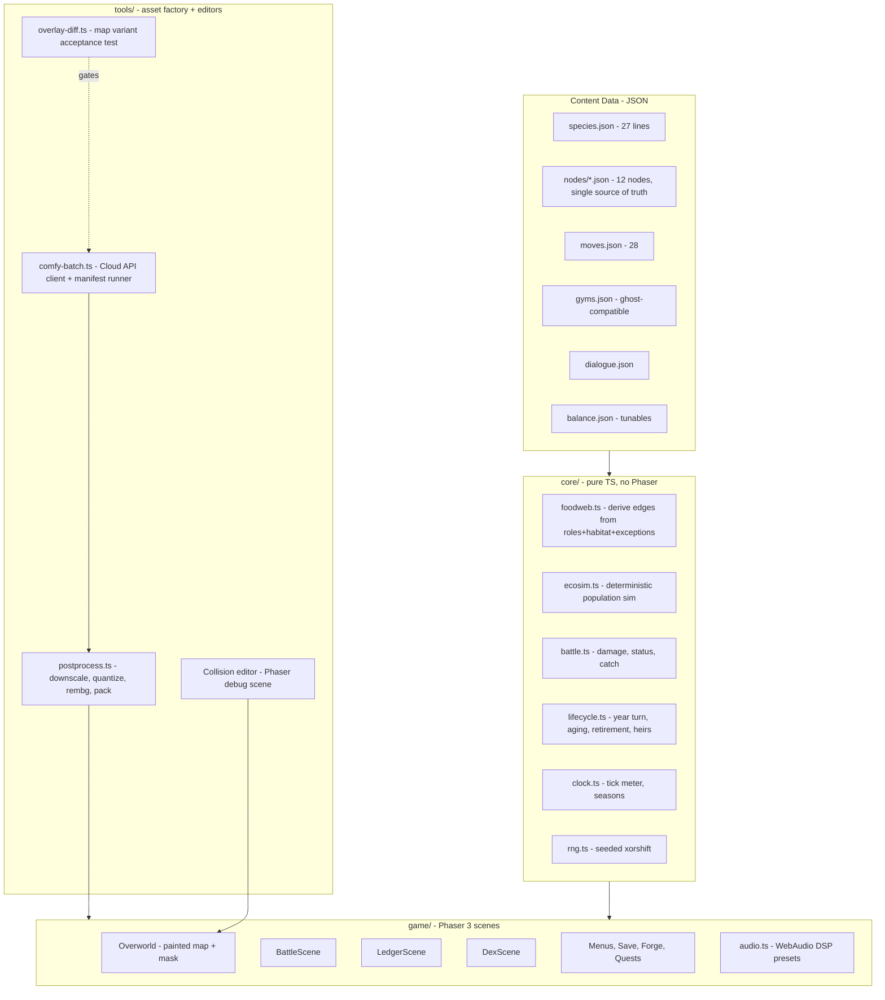

# TROPHIC — Build Doc v1.0

**Audience note (read first).** This document is the single source of truth for the build. It is implemented by an autonomous Claude Code session with no human in the loop except at the marked SUPERVISED gates. `trophic-content-bible.md` ships in the repo at `/docs/content-bible.md` and is the canonical source for all *content* (species tables, type chart values, move pool, gym rosters, towns, quests, dialogue subjects, audio manifest); this doc is canonical for all *decisions, schemas, pipeline, and build order*. Where this doc inlines a formula or schema, the inlined version wins. Any deviation from this doc requires a flagged note in `DEVIATIONS.md` with rationale — never a silent change. Locked decisions are never relitigated.

## 1. Mission & Effort Allocation

Trophic is a 2D Pokémon-Gold-style monster-catching RPG in which the region is a living ecosystem: catching decrements real per-node populations, over-catching cascades through a derived food web, and time advances on its own — ageing every creature, map, and town — whether or not the player is making progress.

**Two clocks (see §3 L8 as amended, and `DEVIATIONS.md` D-Q3-1).** The **calendar** runs on ticks and is unbounded; **six in-game years** is the *expected* count under normal pacing (`balance.clock.yearsTotal`), a correlation and not a rule. **Acts** run on badges and quest flags and carry the story. A fast player reaches the Sanctum with young creatures; a slow player reaches the same content having buried two generations. Both see the whole story, and the difference is written in the ledger.

**Judged output: demo video + AI interview.** There is no hidden rubric beyond these, so effort allocates to what the video shows and the interview probes:

- **~40% — the two demo beats** (never-cut): (1) *Cascade*: hammer a prey species in year 1; open year 2 with its predator gone, a new apex risen, and the aged map. (2) *Legacy*: starter retires before the league; its heir fights the finale.
- **~25% — vertical slice walkability**: Hearthollow → R1 → Brackwater → R2 as painted walkable maps with encounters, battles, catching, ledger.
- **~20% — deterministic core + tests**: battle engine, ecology sim, aging — headless, property-tested, harness-tunable. This is the interview ammunition.
- **~15% — everything else** (remaining nodes as vignettes, audio, dex, polish), all cut-safe.

Demo/UI polish is graded here (the video *is* the deliverable), so polish on the two demo beats outranks polish anywhere else.

## 2. Hard Requirements (non-negotiable)

1. All gameplay art is AI-generated via the validated Comfy Cloud pipeline (§9.3); all code agent-built.
2. Catching decrements the real population of that species at that node; the in-game ledger shows real numbers, never proxies.
3. One JSON file per node is simultaneously: encounter table source, ecology-sim state, and bait lookup. No second table may exist (guardrail G3).
4. Everything ages at year turns, including boxed creatures. Sole exception: caught Ancients. *(The year turn fires on the full meter only — L8 as amended, `DEVIATIONS.md` D-Q2-1. Ageing is the CALENDAR's job and is untouched by the act model.)*
5. Year-variant maps are img2img with layout frozen: **one collision mask per map survives all six years**, enforced by the overlay-diff acceptance test (§8.2).
6. Season variation is a runtime tint shader; year variation is art. Never generate seasonal map art.
7. Vellsire finale: catchable with honest costs — catch removes the keystone buff and the epilogue ledger shows the numbers; release = restoration ending. No moralizing text anywhere; the ledger is the moral.
8. Battle content exactly per bible: 8 types + Predation rule, 5 stats, 28-move pool, 4 statuses, levels 1–40, damage formula §7.4, KO = faint only.
9. Gym rosters fixed per bible §7 (sizes **3**/4/5/6/6/6 — **AMENDED 2026-08-25**, was 4/4/5/6/6/6); leader slots use the ghost-compatible schema (§7.7) but no ghost-team feature is built. The leftmost column of bible §7 (labelled "Yr") is an **ACT index** and ships as `data/gyms.json` `act` — renamed from `year` on 2026-08-25 so nothing re-conflates the two clocks (`DEVIATIONS.md` D-Q3-1). Beating a leader writes its badge flag and may advance the act; **it does not end the year.**
   *Gym 1 only.* Maribel fields three, not four: the duplicate Nibbin (A) slot is cut and she keeps Bramblehog (A), Skir (A) and the signature "Old Nib" Nibbin (E). Authorised by Hank on the balance-harness finding that gym 1 was the hardest fight in the game (26.0% measured against this doc's own §10.5 target of 80–95%, against the year-6 finale's 36.2%). Which creature to cut was decided by a 500-seed measurement of all three candidates, not by taste. The sizes are enforced by `core/schemas.ts` `GYM_ROSTER_SIZES` at boot as well as by `tests/unit/transcription.test.ts`. Full rationale, the measurements, and the gap that remains open: `docs/DEVIATIONS.md` rows D-A5-G1…G4.
10. Seasonal spawns v1-lite: exactly 4 migrants (Pollywisp/Reedrick/Gloomoth/Wispurr); dex + sign cards flag them dormant/migrating out of season.
11. Audio: single CC0 chiptune pack family curated against bible §12a; procedural SFX; DSP season presets + progressive year darkening. Retirement cue chosen first.
12. Web-deployable build (static hosting) — the demo must run from a URL or `npm run preview`.

## 3. Locked Decisions

| # | Decision | Choice | Rationale (one line) |
|---|---|---|---|
| L1 | Name | **Trophic** | Workshopped and confirmed; region stays Fallowmere. |
| L2 | Engine/stack | **Phaser 3 + TypeScript + Vite** | Painted-map+mask is image+bitmap; max agent training coverage; frictionless web demo. |
| L3 | Art platform | **Comfy Cloud API** (paid tier confirmed) | Official API, compatible with local ComfyUI API; SDK batch scripting. |
| L4 | Art model/settings | z_image_turbo, 8 steps, cfg 1.0, res_multistep/simple, 1024², fixed seed per asset | Validated by live trials; template skeleton is the style lock. |
| L5 | Walk cycle | **Comfy reference-guided (img2img) trial first**, acceptance bar §9.6; **procedural bob is the committed fallback** | User call: try it properly, bounded; bob is proven-acceptable. |
| L6 | Player sprite | Green shirt, ranger cap w/ star badge, leather satchel, walking boots, **no cape**. Finalization gate (§15 B0) precedes all multi-version generation | Explicit review lock + user wants one more iteration pass first. |
| L7 | Map structure | Node graph; each node a whole painted map + collision mask; no tilesets | Locked in ideation; vertical slice walkable, rest vignette-fallback. |
| L8 | Time | 16-tick season meter; travel 1 / foray 1 / inn 2; **year = full meter**. The calendar is **unbounded** and independent of story progress. | Locked, then **AMENDED 2026-08-25 by Hank overriding his own lock** — see `DEVIATIONS.md` D-Q2-1 / D-Q3-1. Gym victory is no longer a year-end trigger, and there is no year cap or fail state. |
| L9 | Aging/evolution | J3/A2/E1 lifespans; ×0.75/1.0/1.15; hybrid metamorphic model; heir-or-boon retirement | Locked. |
| L10 | Sim | Deterministic, seeded; pure function of (initial state, action log) | Enables replay, tests, and the balance harness for free. |
| L11 | Core code | Engine-agnostic pure TS in `/core`, zero Phaser imports | Balance harness and tests import the same module the game runs. |
| L12 | Save | Versioned JSON in localStorage, 3 slots | Zero backend; sufficient for demo. |
| L13 | Balance harness | Headless autobattler in-scope (§10.5) | Overnight tuning of §1–§3 constants is how numbers get honest. |

## 4. Architecture



**Runtime narrative (one frame of play):**
1. Boot loads `balance.json`, all content JSON, and the save (or seeds a new one: RNG seed + copies of every node JSON as live sim state).
2. Overworld renders the node's painted map image, plus its year variant if `year > 1` and the variant passed overlay-diff. Movement queries the collision mask grid (§7.6). Season tint shader applies from `clock.season`.
3. A foray step rolls encounters: weights are **live population counts** from the node state (dead species literally stop appearing). Migrants filtered by season.
4. Battle runs entirely in `core/battle.ts` off a serialized `BattleInput`; the Phaser scene is a renderer of its event log. Catch success moves one individual from node population to party/box.
5. Ticks accrue (travel/foray/inn). At each season boundary (every 4 ticks) `ecosim.step()` runs the population update (§7.3). At tick 16 — **and at nothing else** — the **year turn** runs: festival, aging of every owned+boxed creature, retirement flow for expiring creatures, map variant swap, town aging arcs. The calendar never waits and never ends.
5a. **The second clock (§3 L8 as amended, `core/acts.ts`).** ACTS are driven by badges and quest flags and never by time. An act advances when its `balance.acts.gates` row is satisfied; entering an act fires that act's **event scripts (Cullbrand raids)**, unlocks its towns and routes, and carries its story beats, rival encounter and — at the last act — the finale. The two clocks never read each other: the year turn moves no act, and no act moves a tick. There is no fail state, no time limit and no year cap.
6. Ledger scene renders the node JSON's live numbers + the derived web graph. The epilogue reuses the same renderer over the final state — the ending is a ledger read.

## 5. Repo Layout

```
trophic/
├── docs/
│   ├── content-bible.md          # canonical content (checked in verbatim)
│   ├── build-doc.md              # this file
│   └── DEVIATIONS.md
├── data/                         # all JSON content (§7)
│   ├── species.json  moves.json  gyms.json  dialogue.json  balance.json
│   ├── palette.json              # frozen 32-color project palette
│   └── nodes/  (hearthollow.json, r1.json, brackwater.json, r2.json, …)
├── core/                         # pure TS, zero engine imports (L11)
├── game/                         # Phaser scenes, boot, audio
├── tools/
│   ├── comfy/                    # API client, workflow_api.json exports, manifest
│   ├── postprocess/
│   ├── collision-editor/         # runs as a Vite dev target
│   ├── overlay-diff/
│   └── harness/                  # balance autobattler (imports core/)
├── assets/
│   ├── raw/                      # Comfy outputs (gitignored except manifest)
│   ├── final/                    # post-processed, packed, committed
│   └── audio/  (+ ATTRIBUTION.md if CC-BY)
├── tests/
├── public/  index.html  vite.config.ts  package.json  .env.example
```

## 6. Config & Secrets

`.env.example` (never commit `.env`):
```
COMFY_CLOUD_API_KEY=comfyui-xxxxxxxxxxxx     # paid tier; API + UI share one credit pool
COMFY_HOST=https://cloud.comfy.org
```
API docs: https://docs.comfy.org/development/cloud/overview (Cloud API is compatible with the local ComfyUI API; use the official SDK or raw HTTP).

`data/balance.json` holds every tunable named in §7 (multipliers, breed/starve rates, catch constants, XP curve, encounter rates, thresholds). **Invariants, each backed by a named test:**
- **INV-1** Adding a species touches `species.json`, one node JSON, and assets only — no code. Test `ext_add_species`.
- **INV-2** Adding a node touches `data/nodes/` + assets + graph adjacency only. Test `ext_add_node`.
- **INV-3** Retuning balance touches `balance.json` only. Test `ext_retune` (harness runs with an overridden file).
- **INV-4** No gameplay constant may be a literal in code; all read from `balance.json`. Test `no_magic_numbers` (lint rule / grep gate).

## 7. Data Models (fully typed)

All content is TypeScript-typed via `core/types.ts`; JSON files are validated against these at boot with zod (fail loud on drift).

### 7.1 Species (`species.json`) — 27 lines
```ts
type TypeName = "Beast"|"Fire"|"Water"|"Plant"|"Earth"|"Wind"|"Poison"|"Dark";
type Role = "Producer"|"Grazer"|"Mesopredator"|"Apex"|"Scavenger"|"AncientApex";
type AgeClass = "J"|"A"|"E";
type Season = "spring"|"summer"|"autumn"|"winter";

interface SpeciesLine {
  id: string;                     // "mirefin-line"
  dexIds: string[];               // named identities for dex art (35 total incl. age names)
  formNames: Record<AgeClass,string>;   // e.g. {J:"Bogling", A:"Mirefin", E:"Mirefin"}
  types: Record<AgeClass, TypeName[]>;  // per-age (metamorphic lines shift here)
  role: Record<AgeClass, Role>;         // per-age (Bogling Grazer -> Mirefin Mesopredator)
  habitat: string[];              // node biome tags; "roaming" = all
  baseStats: {hp:number; atk:number; def:number; spd:number; ins:number}; // 30–100
  metamorphic: boolean;           // true => ×1.15 extra on J->A transition
  ancient: boolean;               // never ages, always E, exempt from year turns
  seasonalWindow?: Season;        // only the 4 migrants have this
  movePool: {type1:string; type2:string; role:string; utility:string}; // ids into moves.json, unlock 1/5/10/15
  dietExceptions?: string[];      // extra prey line-ids (Fenmaw -> Reedrick)
  presenceEffect?: "keystoneBreed"|"ventWarmth"|"waterTable"; // Ancients only
}
```
Content values come verbatim from bible §4; the agent transcribes, never invents. 27 entries (25 aging lines + Kilnback + Undermere; Vellsire is an aging-exempt line entry with `ancient:true`).

### 7.2 Node (`data/nodes/*.json`) — THE chokepoint schema
```ts
interface NodeFile {
  id: string; name: string; biome: string;
  adjacency: string[];            // node graph edges
  walkable: boolean;              // false => vignette card fallback
  mapAsset: string;               // base painted map
  yearVariants: Partial<Record<2|3|4|5|6,string>>; // only overlay-diff-passed variants listed
  collisionMask: string;          // ONE per node, all years (Hard Req 5)
  floraStock: number;             // abstract producer stock, 0–100
  populations: Record<string,{   // key = species line id
    count: number;                // integer individuals; ledger shows THIS number
    breedRate: number;            // per-season fractional growth
    carryCap: number;
  }>;
  props: PropPlacement[];         // antler stones, shrines, idols — sign-chain trailheads
  spawnTables: never;             // deliberately untyped: encounter weights are DERIVED (G3)
}
```
**Derivations (never stored):** encounter weight of species s = `populations[s].count` (0 count = 0 encounters — the cascade is visible for free), filtered by `seasonalWindow`, Scavenger weight × `(1 + recentDeaths/10)`. Bait lookup: bait matches target if bait's tag ∈ target's derived diet (7.3). Sim initial state = the file as shipped.

### 7.3 Food Web Derivation + Population Step (`core/foodweb.ts`, `core/ecosim.ts`)
Edges derived per node, per bible §5: Apex eats {Mesopredator, large Grazer} in habitat; Mesopredator eats Grazers; Grazers eat Producers + floraStock; Scavengers eat nothing live; plus each species' `dietExceptions`; Ancients eat nothing (presence effects instead).

`ecosim.step(node, season, rng)` — runs at every season boundary, numbered:
1. `births[s] = count[s] × breedRate[s] × foodFactor(s) × presenceMult(s)` — foodFactor = clamp(availablePrey / demand, 0.25, 1.25); presenceMult per Ancient effects (Vellsire adjacent-node breeding ×1.5 while free; Kilnback: Fire spawns active; Undermere: Water breedRate floor).
2. `starvation[s]`: if availablePrey/demand < `balance.starveThreshold` (default 0.4), deaths = count × `starveRate` (default 0.3).
3. Predation transfer: each predator consumes `predationDraw` (default 0.1 × predatorCount) from prey pools, proportionally across its prey.
4. Clamp to [0, carryCap]; round via seeded RNG (stochastic rounding so small populations can die out or recover — determinism preserved by seed).
5. `recentDeaths` accumulator updates (drives Carricrow weight).
6. **Cascade emergence check (not scripted):** these rules alone must produce mesopredator-release when an apex's prey is over-caught. Verified by test `cascade_emerges` (§10.2), not by special-case code. DO NOT hard-code the demo cascade (G6).

All constants live in `balance.json`. Player catch/release directly increments/decrements `count` at action time.

### 7.4 Battle (`core/battle.ts`)
- Effective stat = `base × ageMult × (1 + 0.02 × level) + traitMods` (ageMult .75/1.0/1.15; metamorphic J→A adds ×1.15 once).
- `damage = (atk × movePower / def) × typeMult × predation × roll(0.9,1.1)`; typeMult from bible §1 chart transcribed into `moves.json`; predation = 1.25 if attacker's derived diet includes defender's line.
- Statuses (4): Burn 6%/turn chip; Toxin 4% ramping +2%/turn; Soak −30% Speed; Daze 25% skip. One status at a time, newest wins.
- **Catch formula (build-doc addition, tunable) — AMENDED 2026-08-25, see DEVIATIONS D-A5-1:** `p = baseCatch(age) × snareTier × (baitMult × instinctBait(catcher)) × (2 − hpFrac) / 2 × lureMult`, with baseCatch J .5 / A .3 / E .15 (Ancients .05), snareTier 1/1.5/2.2, baitMult 1.5 diet-match role bait / 2.0 species bait, lure ×1.5. Clamp .02–.95.
  - The **Instinct term** is bible §2's second job for Instinct ("bait success"), and it multiplies the bait term: `instinctBait(c) = 1 + instinctBaitSlope × (insShare(c) − instinctBaitPivot)`, where `insShare(c) = c.ins / (c.hp + c.atk + c.def + c.spd + c.ins)` over the CATCHING creature's effective stats (traits and boons included; in-battle stat mods excluded). Shipped `instinctBaitPivot` .15, `instinctBaitSlope` 3. A catch with no named catcher takes the pivot, i.e. `instinctBait = 1`.
  - It reads the **allocation**, not the raw stat: every non-Ancient line spends exactly 300 base points, and age/level/metamorphic/Beast are common to all five stats and cancel out of the ratio — so this rebalances WHO catches well and does not become a catch rate that climbs with the player's level. The pivot is the roster's median Instinct allocation (45/300), so a median catcher is unchanged from the pre-amendment formula; across the 24 non-Ancient lines the term spans ×0.846 to ×1.257, roster mean ×1.010. It is continuous, strictly increasing in Instinct, and positive over the whole possible share range (0.55 at share 0), so it needs no clamp of its own — .02–.95 remains the only clamp.
  - Every constant is in `balance.catch` (`instinctBaitPivot`, `instinctBaitSlope`); nothing is a literal in code (G11).
- **XP (build-doc addition, tunable):** `xpGain = 12 + 4×enemyLevel × ageBonus(E:1.3)`; `xpToNext(l) = 15 × l^1.4`. Cap level 40.
- Flee: `pFlee = 0.4 + 0.4 × (mySpd/theirSpd)`, clamp .1–.95.
- Battle is a pure reducer: `(BattleState, Action, rng) => {state, events[]}`. The Phaser scene replays `events[]`. Test surface = feed action scripts headless.

### 7.5 Party, Aging, Retirement (`core/lifecycle.ts`)
```ts
interface OwnedCreature {
  uid: string; lineId: string; age: AgeClass; level: number;
  caughtYear: number; yearsRemaining: number;   // J:3 A:2 E:1 at catch
  traits: Trait[];  relicSlot?: string;  boons: Boon[];
  projectedRetirementYear: number;              // displayed on card (Hard Req from bible)
}
```
Year turn, numbered: (1) every owned + boxed non-Ancient creature: `yearsRemaining--`, age class advances J→A→E on its schedule; (2) metamorphic transitions apply name/type/role/stat-jump; (3) any creature at 0 → **retirement flow**: player chooses HEIR (new J of same line, level = floor(parent×0.5), inherits 1–2 randomly chosen parent traits + parent's relic slot unlocked) or BOON (chosen teammate gains permanent +10% to one stat, named after the retiree); (4) Ancients skipped; (5) node sims run their 4th season step; (6) map year-variant swap if present.

**AMENDED 2026-08-25 (`DEVIATIONS.md` D-Q3-1).** Step 5's second half — "*+ year events (Cullbrand raid scripts decrement scripted node populations)*" — has **moved off the calendar**. bible §9 says the raids are "scripted per **act**", and `balance.yearEvents.raids` is now keyed by `act`, applied by `core/lifecycle.ts` `enterPendingActs` on entry to that act. A year turn fires no raid, ever. Everything else in the numbered turn is unchanged.

**Step 6 resolves through §9.5's fallback, not through an exact-year lookup.** `yearVariants` only ever holds keys 2–6 (§7.2) and the calendar is unbounded, so "the variant listed for exactly this year" answers nothing past year 6 and a year-9 node would fall back to the *base* map — younger than the year-6 art already on screen. §9.5 already settles it ("that year reuses the nearest passing variant"): `mapAssetForYear` resolves downward, and the turn reports a swap when the RESOLVED asset changes. A year-9 Hearthollow renders as year-6 Hearthollow.

### 7.6 Maps & Collision
Virtual resolution 480×320, integer-scaled. Painted maps 1024×1024 native rendered 2× (2048² world). Collision mask: 1-bit PNG at map native res, sampled on a 16px grid (64×64 cells) into a packed bitfield at build time. Player logical sprite 32×48, tile step 32px, grid movement Gold-style. Props are entries in `props[]` with interaction radius, not baked into collision (they overlay the painted map).

### 7.7 Gyms (`gyms.json`) — ghost-compatible schema
```ts
interface GymTeamSlot { lineId:string; age:AgeClass; level:number; traits?:Trait[]; nickname?:string; }
interface GymLeader { id:string; name:string; act:number; town:string; type:TypeName|"mixed"; slots:GymTeamSlot[]; signature:GymTeamSlot; source:"fixed"|"ghost"; }
```
`act` is bible §7's leftmost column, which the bible labels "Yr". It is an **act index and not a calendar year** — renamed from `year` on 2026-08-25 (`DEVIATIONS.md` D-Q3-1) because it was never anything else: `tools/harness/player.ts` has always read it as "how far along the player is". `name` is additive (`DEVIATIONS.md` D5).
All six shipped with `source:"fixed"`, rosters transcribed from bible §7. `"ghost"` is schema-only (Hard Req 9); building any ghost feature is guardrail G8.

### 7.8 Save
`{version:1, seed, year, tick, currentNode, party[], box[], money, items, questFlags, nodeStates (full NodeFile.populations+floraStock per node), actionLog[]}` — localStorage, 3 slots. `nodeStates` is the live sim; `actionLog` enables deterministic replay (L10). Migration: refuse older versions with a clear message (demo scope).

## 8. Cross-Cutting Load-Bearing Specs

### 8.1 Determinism (→ tests `det_replay`, `det_sim`)
One seeded xorshift128 stream per subsystem (battle, sim, encounters), seeds derived from save seed + subsystem tag. Property: identical (seed, actionLog) ⇒ byte-identical final save. No `Math.random` anywhere (lint gate).

### 8.2 Map-variant layout freeze (→ test `overlay_diff`, gates the art lane)
`tools/overlay-diff`: threshold both base map and candidate year variant to walkability-relevant edges (Sobel on luminance), dilate 2px, compute IoU of edge maps **restricted to the walkable cells of the collision mask**. Accept iff IoU ≥ 0.85 (tunable). A failing variant is regenerated at lower denoise (start 0.35, step −0.05, floor 0.2) — never accepted manually without a DEVIATIONS entry. This is what makes "one mask, six years" true rather than hoped.

### 8.3 Single-source-of-truth (→ test `no_shadow_tables`)
Grep/AST gate: no file other than `core/foodweb.ts` may compute diet edges; no encounter-weight literal tables anywhere; ledger UI reads `nodeStates` objects directly.

### 8.4 Style lock (art)
Every generation uses the L4 settings + the template skeleton verbatim (§9.2) + the frozen negative prompt + a fixed per-asset seed recorded in the manifest. Post-process quantizes to `palette.json` (32 colors, k-means over the approved trial set, frozen at gate B0). Any asset regenerated must reuse its manifest seed unless the manifest entry is versioned.

## 9. Asset Factory (tools/comfy)

### 9.1 Pipeline shape
Comfy Cloud paid tier confirmed: scripted batch via the official Cloud API (compatible with the local ComfyUI `/prompt`-style API; SDK available). Architecture: the validated trial graph exported once as **API-format workflow JSON** per asset class; `comfy-batch.ts` loads `manifest.json`, injects `{prompt, seed, denoise, init_image}` per row, submits, polls/WebSockets, downloads to `assets/raw/<class>/<assetId>.png`, and records `{assetId, seed, workflowHash, timestamp}` back into the manifest. Concurrency: respect tier limit; retry ×2 on failure then flag for supervised review. Credits are shared with the UI pool — the runner prints a projected-credit estimate before any batch ≥ 20 items and requires `--confirm` (SUPERVISED).

### 9.2 Locked generation parameters (verbatim)
- Model `Comfy-Org/z_image_turbo` + its CLIP lumina2 + Comfy-Org VAE (stock cloud txt2img graph). 8 steps, cfg 1.0, sampler `res_multistep`, scheduler `simple`, 1024×1024, fixed seed per manifest row.
- Negative prompt (all classes): `low quality, bad anatomy, extra digits, missing digits, extra limbs, missing limbs`
- Template skeleton (style lock): `pixel art [ASSET CLASS], retro 90s handheld monster-taming RPG style, [SUBJECT DESCRIPTION], [VIEW/POSE], full body, centered composition, plain white background, [PALETTE NOTE], crisp clean pixel edges, 2D game asset`
- Class variants (proven): creature battle sprite · trainer battle sprite · overworld character sprite (add `small chibi proportions`) · top-down town map (add `three-quarter overhead view, entire town visible, no characters` + `wide walkable paths, spacious layout, clear building entrances`).
- Fidelity rules: front-load and repeat distinctive anatomy (Fenmaw's gharial snout class of failure); accept partial pose adherence, don't over-engineer.
- Player character (L6, verbatim in every player prompt): `green shirt, ranger cap with star badge, leather satchel, walking boots` — never `cape` or `cloak`.

### 9.3 Post-process chain (`tools/postprocess`, required — raw output is pixel-style, not grid-aligned)
Per sprite: (1) nearest-neighbor downscale to target (battle 96², overworld chars 32×48, minis 32²); (2) quantize to `palette.json`; (3) rembg background removal; (4) pack to sprite atlases. Maps: downscale to 1024² retained, quantize, **no rembg**. Every step idempotent and re-runnable from `raw/`.

### 9.4 Untrialed class gate — painted dex illustration
First task of the batch phase (build order B2): a SUPERVISED trial of the painted (non-pixel) dex class. Prompt direction: `painted storybook illustration, natural-history field-guide style, [SUBJECT], soft watercolor texture, muted palette` — iterate to approval before generating the 35. If it can't reach approval in one supervised loop, cut line C4 applies (dex falls back to upscaled pixel sprites on parchment frames) — the game must not block on it.

### 9.5 Aged map variants
img2img on the approved base map, denoise start 0.35, prompt appends the node's aging arc (bible §6: "docks rot", "canopy thins", "vents flare", …), layout frozen; every candidate runs `overlay-diff` (§8.2) before entering the node JSON. Budget: ≤ 3 regen attempts per variant, then that year reuses the nearest passing variant (visual continuity beats variant count).

### 9.6 Walk-cycle trial (L5) — spec
Precondition: gate B0 (player sprite finalized) passed. SUPERVISED, timeboxed to one review loop (~12–16 generations):
1. Inputs: approved player front/back/side statics.
2. Method: img2img per frame with the matching static as init, denoise sweep {0.3, 0.4, 0.5}, prompt appends `mid-step, left foot forward` / `right foot forward`; side frames mirrored for the 4th direction.
3. **Acceptance bar (all required):** cap, satchel, shirt color pixel-stable across frames after quantize; silhouette delta confined to legs/arms (diff mask below torso midline ≥ 90% of changed pixels); reads as a walk at 8 fps in the collision-editor preview.
4. Pass ⇒ pack 4-dir × 3-frame sheet. Fail ⇒ **fall to bob without discussion**: y = 2px sine per tile step, 1px lateral sway, horizontal flip alternation. Bob ships in either case as the NPC animation (NPCs are turn-to-face statics regardless).

### 9.7 Asset manifest (counts, from bible §4 + handoff §4)
154 battle sprites (77 forms × front/back) · 35 painted dex identities (gated §9.4) · 12 base maps + up to 30 accepted year variants (only vertical-slice nodes guaranteed variants; others cut-safe) · overworld minis for encounterable species (~25) · 8 trainer battle sprites (5 leaders + Greaves + Wick + Maren) · ambient NPC statics (~12 reusable) · prop set (antler stones, shell-kiln shrines, sunken idols, sign-card frame) · UI frames · player statics + walk sheet (or bob). Manifest rows carry: id, class, subject string, view, seed, target size, status (pending/raw/final/approved).

## 10. Test Plan

Runner: vitest. Core suite must pass headless with no Phaser installed (proves L11).

1. **Unit:** damage formula table-driven against hand-computed cases incl. Predation and Beast +10%; status tick math; catch/flee clamps; XP curve; effective-stat incl. metamorphic jump.
2. **Property (fast-check):** `pop_bounds` populations always integer ∈ [0, carryCap]; `det_sim` same seed ⇒ same 6-year trajectory; `det_replay` (§8.1); `cascade_emerges` — property: for any node with an Apex, forcing its primary prey to <10% for 2 consecutive seasons yields apex count →0 and mesopredator count strictly rising within 4 seasons (this is the demo beat as a law, not a script); `migrant_legibility` — out-of-season migrant never appears in encounters AND its dex flag reads dormant/migrating.
3. **Invariant gates:** INV-1..4 (§6), `no_shadow_tables` (§8.3), `no_magic_numbers`, no-`Math.random` lint.
4. **Pipeline tests:** `overlay_diff` self-test on synthetic pairs (translated layout must fail, texture-only change must pass); postprocess idempotency; manifest seed-reuse enforcement.
5. **Balance harness (`tools/harness`, L13):** headless autobattler importing `core/battle.ts`. Modes: (a) gym-sim — a scripted "reasonable player" party per year vs each gym roster, 500 seeds, report win rate (targets: gyms 1–2 ∈ [80,95]%, 3–4 ∈ [60,80]%, 5–6 ∈ [45,65]%); (b) type-chart round-robin — every line vs every line at equal level, flag any line with <35% or >65% aggregate winrate; (c) full-run sim — 6 years of scripted catching against the sim, assert no unintended extinction under normal play and guaranteed cascade under over-catch script. Output: markdown report + suggested `balance.json` deltas. Overnight loop: agent runs harness → adjusts `balance.json` only (INV-3) → reruns → commits report.
6. **Acceptance tests per extensibility invariant** as named in §6.

## 11. Fixtures
Synthetic only: `fixtures/mini-node.json` (3 species, tiny counts — hand-checkable sim math); `fixtures/battle-scripts/*.json` (action logs incl. gym fights); `fixtures/overcatch-script.json` (the demo cascade as an action log — used by tests AND by the demo-recording flow); stress fixture `fixtures/mega-node.json` (all 27 lines, counts ×100 — sim step must stay <5ms, §12).

## 12. Performance Notes
Modest, but tested: overworld 60fps at 480×320 integer scale (painted map is one static image + one sprite layer — trivially fine); `ecosim.step` all 12 nodes < 5ms (benchmark test `perf_sim` with margin ×4 on mega-node); battle reducer < 1ms/action; boot < 3s on broadband (atlas packing + lazy-load painted dex art). Save serialize < 50ms.

## 13. README / Interview Prep (write into repo README.md)
Sections: what it is (2 paragraphs + the two demo beats as GIFs), architecture diagram, "the ledger is the moral" design note, honest known-gaps list (e.g. sim constants tuned for legibility not realism; catch formula is an invented tunable; vignette nodes if cut). **Pre-written answers, full arguments, to the evaluation questions the AI interview will probe:**
- *How was AI used?* Full pipeline: agent-built code from this doc; all art via Comfy Cloud API batch (settings §9.2), style held by a locked prompt skeleton + frozen palette, zero LoRAs; balance tuned by an autonomous harness loop.
- *How do you know the ecology works?* It's a law, not a script: `cascade_emerges` property test; deterministic replay; the demo cascade is a recorded action log any reviewer can re-run.
- *Why no tilesets?* Whole-painted maps + one collision mask trade tile flexibility for AI-generatable art; the layout-freeze overlay-diff test is what makes six-year aging affordable.
- *What would break at scale?* Honest: JSON-in-localStorage saves, O(n²) web derivation fine at 27 lines, palette lock limits art variety.
- *What was cut and why* — filled from the cut-line record at submission time.

## 14. Dev Setup
```
npm i && cp .env.example .env    # add COMFY_CLOUD_API_KEY (asset work only; game runs without it)
npm run dev        # game at :5173
npm run test       # core suite (no key, no Phaser needed for core tests)
npm run harness    # balance report
npm run collision  # collision editor on :5174
npm run factory -- --manifest tools/comfy/manifest.json --class battle --confirm
npm run build && npm run preview
```
Node 20+. No Docker needed (static web build); optional `Dockerfile` is stretch S4.

## 15. Build Order (agentic lanes, acceptance gate per step — do not proceed past a gate with failing tests)

Estimates are agentic-execution units: an unsupervised stretch = one continuous agent run; SUPERVISED = requires Hank review via chat/Chrome extension.

**Gate B0 (SUPERVISED, first):** player-sprite finalization loop — iterate the main character statics with Hank until approved; freeze `palette.json` from the approved set. Nothing multi-version (walk trial, overworld batch) starts before B0.

**Lane A — core (unsupervised, parallel-safe):**
A1 types + zod schemas + content transcription from bible (species/moves/gyms/type chart) → gate: schemas validate, transcription spot-check test vs bible tables. A2 rng/clock/foodweb/ecosim + property tests → gate: §10.2 green incl. `cascade_emerges`. A3 battle reducer + unit suite. A4 lifecycle/year-turn + retirement. A5 harness + first overnight tuning loop.

**Lane B — asset factory (needs B0):**
B1 Cloud API client + manifest runner + postprocess on trial assets → gate: one asset per pixel class reproduced from manifest byte-identically. B2 painted-dex trial (SUPERVISED, §9.4). B3 battle-sprite batch (154) in class chunks with Chrome-extension review checkpoints every ~40. B4 vertical-slice maps (4) + collision masks via editor (SUPERVISED, ~1 review per map) + year-2 variants through overlay-diff. B5 walk-cycle trial (SUPERVISED, §9.6). B6 remaining maps/minis/props/UI.

**Lane C — game shell (parallel with A/B, placeholder art until B lands):**
C1 boot/save/menus. C2 overworld: painted map + mask movement + encounters off node JSON. C3 battle scene as event-log renderer. C4 ledger + dex + summary (projected retirement year on card). C5 tick meter/seasons/tint shader. C6 year turn UX: festival, aging, retirement flow. C7 quests/dialogue/props/sign chains (vertical slice quests first: First Signs, Fallow Field, Restock the Shallows, Ferryman's Wager) + opening/tutorial beat (bible §13.15: 3–4 painted stills — ride the §9.4 painted-class trial, pixel-still fallback — + Maren dialogue; dialogue budget ~10 lines/named NPC, ~3/ambient per bible §13.13). C8 audio: pack curation (SUPERVISED — retirement cue first, bible §12a manifest), WebAudio DSP presets, procedural SFX. C9 remaining nodes as vignette cards + acts 3–6 story beats + finale/epilogue ledger.

**Integration gates:** I1 vertical slice playable end-to-end (catch, battle, ledger moves, year turn). I2 **cascade demo reproducible from `overcatch-script.json` in real play.** I3 **retirement/heir beat playable.** I4 finale + both endings + epilogue ledger. I5 full test suite + harness targets green. I6 demo-video dry run.

**Cut lines (in order — cut from the bottom up):** C-1 acts 5–6 towns walkable → vignettes (already default). C-2 year variants beyond year 2 for non-slice nodes. C-3 side quests beyond the 4 slice quests. C-4 painted dex class (fallback §9.4). C-5 Kilnback/Undermere catch chains → lore-only. C-6 forge/relics UI → auto-apply relics. **Never cut:** the two demo beats, vertical-slice walkability, real-number ledger, retirement flow, Vellsire choice + epilogue ledger, determinism tests.

**Stretch (flagged, cut-safe):** S1 Retro Diffusion walk-sheet exploration (only if B5 fails AND schedule is ahead). S2 full per-species seasonal tables. S3 ghost gym ingestion of saved teams (schema exists). S4 Dockerfile. S5 Nuzlocke permadeath toggle.

## 16. Agent Guardrails — DO NOT
- G1 Do not build or generate tilesets, or slice painted maps into tiles.
- G2 Do not invent species, moves, types, statuses, towns, or roster changes — bible values verbatim; discrepancies go to DEVIATIONS.md, not fixes.
- G3 Do not create any second encounter/spawn/bait table — all derived from node JSON (test-enforced).
- G4 Do not accept a map year-variant that hasn't passed overlay-diff; do not hand-edit collision masks to fit a drifted variant.
- G5 Do not regenerate an approved asset without reusing its manifest seed (or versioning the row).
- G6 Do not script the demo cascade into the sim — it must emerge from the §7.3 rules (the action-log fixture drives play, not the sim).
- G7 Do not write moralizing copy about catching anywhere — numbers only; the ledger is the moral.
- G8 Do not build ghost-team features; schema only.
- G9 Do not mix audio packs or exceed one composer family; no CC-BY without ATTRIBUTION.md.
- G10 Do not skip year-turn aging for boxed creatures, and do not age caught Ancients.
- G11 Do not put gameplay constants in code (balance.json only) or use Math.random.
- G12 Do not report effort in human engineering-hours anywhere (docs, comments, commits) — agentic-execution terms only.
- G13 Do not run a ≥20-item generation batch without the credit estimate + --confirm step.
- G14 Do not proceed past a gate with failing tests; do not mark a step done before its named tests exist and pass.
- G15 Do not ship coined names publicly without the IP-sweep checklist item being checked by Hank.

## 17. Requirements Traceability

| Source item | Covering section |
|---|---|
| Handoff §2 structure (node graph, painted maps, slice) | §3 L7, §7.2, §7.6, §15 |
| Handoff §2 time / aging / evolution / Ancients | §3 L8–L9, §7.1, §7.5, G10 |
| Handoff §2 ecology + single source of truth | §7.2–7.3, §8.3, G3 |
| Handoff §2 seasonal v1-lite + legibility | Hard Req 10, §7.1, test `migrant_legibility` |
| Handoff §2 finale honest costs | Hard Req 7, §7.3 presence effects, §15 I4, G7 |
| Handoff §2 battle/gyms | Hard Req 8–9, §7.4, §7.7 |
| Handoff §2 art split + §3 pipeline + fidelity rules | §9.2–9.3, §8.4 |
| Handoff §3 layout-frozen img2img / one mask | Hard Req 5, §8.2, §9.5, G4 |
| Handoff §4 asset manifest | §9.7 |
| Handoff §5a batch API | §9.1 (resolved: paid tier, official Cloud API) |
| Handoff §5b engine/stack/save | §3 L2, L11–L12, §5, §7.8 |
| Handoff §5c walk cycle | §3 L5–L6, §9.6, S1 |
| Handoff §5d collision tooling | §5 tools/collision-editor, §15 B4 |
| Handoff §5e balance harness | §3 L13, §10.5 |
| Handoff §5f audio selection | Hard Req 11, §15 C8, G9 |
| Handoff §6 demo arc protection | §1 allocation, §15 I2–I3, never-cut list |
| Bible §12a audio manifest | §15 C8 (curation against it), G9 |
| Bible §13 flagged gaps (all resolved items) | §7.4 (formulas), §7.5 (box aging), §15 C7 (dialogue), G15 (IP sweep) |
| Working prefs: agentic time framing, tappable decisions, stretch flagged | §15 framing, G12, §15 Stretch |

## 18. Human Pre-Submission Checklist (agent cannot do these)
- [ ] B0 sprite approval + palette freeze done in review session
- [ ] Comfy credit balance sufficient before B3 batch (runner prints estimate)
- [ ] IP sweep: game name TROPHIC + all coined names quick trademark/steam/itch collision pass (G15)
- [ ] Audio pack license verified; ATTRIBUTION.md if CC-BY
- [ ] Record demo video: cascade beat from the fixture script, retirement beat, finale ledger
- [ ] Repo visibility + clean-clone `npm i && npm run dev` on a fresh machine
- [ ] Secret sweep: no COMFY key in git history (`git log -p | grep comfyui-` clean)
- [ ] Save-wipe playtest: new game to gym 1 without dev tools
