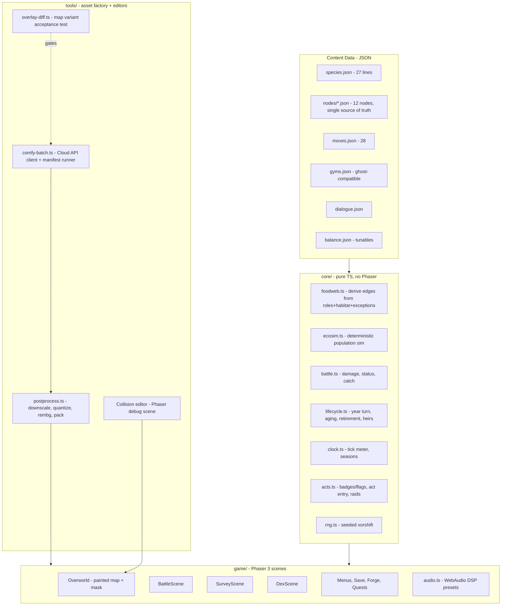

# TROPHIC — Build Doc v1.0

**Audience note (read first).** This document is canonical for all *decisions, schemas, formulas, pipeline, and build order*. `docs/content-bible.md` is canonical for all *content* (species tables, type chart, move pool, gym rosters, towns, quests, dialogue subjects, audio manifest). Where this doc inlines a formula or schema, the inlined version wins. Locked decisions are relitigated only by Hank overriding his own lock, and the override is folded in here rather than logged elsewhere.

**Where a reason lives.** A reason that must not be lost belongs in a **code comment on the line it constrains** — that is where it is read when someone edits it. A rule that constrains the project belongs in **this document**, as a rule, with no id and no history. What is open, in flight, or waiting on Hank belongs in `docs/STATUS.md`. There is no deviations ledger; git holds the history.

## 1. Mission & Effort Allocation

Trophic is a 2D Pokémon-Gold-style monster-catching RPG in which the region is a living ecosystem: catching decrements real per-node populations, over-catching cascades through a derived food web, and time advances on its own — ageing every creature, map, and town — whether or not the player is making progress. Two independent clocks run it (§3 L8, §4): the **calendar**, which is unbounded, and the **acts**, which carry the story. A fast player reaches the Sanctum with young creatures; a slow player reaches the same content having buried two generations. Both see the whole story, and the difference is written in the survey.

**Judged output: demo video + AI interview.** There is no hidden rubric beyond these, so effort allocates to what the video shows and the interview probes:

- **~40% — the two demo beats** (never-cut): (1) *Cascade*: hammer a prey species in year 1; open year 2 with its predator gone, a new apex risen, and the aged map. (**§10.2 is where this beat's guarantees live** — the predator's collapse is asserted as a law; which node produces a risen apex on top of it is a property of that node's food web, never a script.) ⚠ **"and the aged map" is DEFERRED by the owner, first-hand — the beat is not cut, its map third is** (§9.5, §15 S6). The ecology two-thirds are built and gated by §15 I2; year-variant art is a stretch goal and `yearVariants` is empty on all twelve nodes. Do not read the beat as unplayable because of it, and do not read the deferral as licence to cut the ecology half. (2) *Legacy*: starter retires before the league; its heir fights the finale.
- **~25% — vertical slice walkability**: Hearthollow → R1 → Brackwater → R2 as painted walkable maps with encounters, battles, catching, survey.
- **~20% — deterministic core + tests**: battle engine, ecology sim, aging — headless, property-tested, harness-tunable. This is the interview ammunition.
- **~15% — everything else** (remaining nodes as vignettes, audio, dex, polish), all cut-safe.

Demo/UI polish is graded here (the video *is* the deliverable), so polish on the two demo beats outranks polish anywhere else.

## 2. Hard Requirements (non-negotiable)

1. All gameplay art is AI-generated via the validated Comfy Cloud pipeline (§9.3); all code agent-built.
2. Catching decrements the real population of that species at that node; the in-game survey shows real numbers, never proxies.
3. One JSON file per node is simultaneously: encounter table source, ecology-sim state, and bait lookup. No second table may exist (guardrail G3).
4. Everything ages at year turns, including boxed creatures. Sole exception: caught Ancients. Ageing is the CALENDAR's job and is untouched by the act model; the year turn fires on the full meter only (§3 L8).
5. Year-variant maps are img2img with layout frozen: **one collision mask per map survives all six years**, enforced by the overlay-diff acceptance test (§8.2).
6. Season variation is a runtime tint shader; year variation is art. Never generate seasonal map art.
7. Vellsire finale: catchable with honest costs — catch removes the keystone buff and the epilogue survey shows the numbers; release = restoration ending. No moralizing text anywhere; the counts are reported plainly and nothing comments on them.
8. Battle content exactly per bible: 8 types + Predation rule, 5 stats, 28-move pool, 4 statuses, levels 1–40, damage formula §7.4, KO = faint only.
9. Gym roster sizes are **3/4/5/6/6/6** and leader slots use the ghost-compatible schema (§7.7), but no ghost-team feature is built. `core/schemas.ts` `GYM_ROSTER_SIZES` hard-fails boot on any other shape. **Gym 1 only:** Maribel fields three, not the bible's four — the duplicate Nibbin (A) slot is cut, she keeps Bramblehog (A), Skir (A) and the signature "Old Nib" Nibbin (E), and her signature premium is **+0**, not +2. Authorised by Hank on a 500-seed measurement that gym 1 was the hardest fight in the game (26.0% against this doc's own §10.5 target of 80–95%). Bible §7 still prints 4/4/5/6/6/6; this doc wins.
10. Seasonal spawns v1-lite: exactly 4 migrants (Pollywisp/Reedrick/Gloomoth/Wispurr); dex + sign cards flag them dormant/migrating out of season.
11. Audio: single CC0 chiptune pack family curated against bible §12a; procedural SFX; DSP season presets + progressive year darkening. Retirement cue chosen first.
12. Web-deployable build (static hosting) — the demo must run from a URL or `npm run preview`.

## 3. Locked Decisions

| # | Decision | Choice | Rationale (one line) |
|---|---|---|---|
| L1 | Names | **TROPHIC**, region **Fallowmere**, and every coined name as shipped | **Affirmed, not provisional.** Hank affirmed the whole flagged set: TROPHIC, Fallowmere, Duskhollow, Duskhollow Vale, Undermere, Mirefin, Gloomoth, Umbrat, Wispurr, Bramblore, Cragmar, Daunt, and the 37-name second tier. Nothing is renamed; no name in `docs/` or `data/` is a placeholder. G15's standing bans are the entire rename list and stay banned. A name already created is never put back to Hank. |
| L2 | Engine/stack | **Phaser 3 + TypeScript + Vite** | Painted-map+mask is image+bitmap; max agent training coverage; frictionless web demo. |
| L3 | Art platform | **Comfy Cloud API** (paid tier confirmed) | Official API, compatible with local ComfyUI API; SDK batch scripting. |
| L4 | Art model/settings | z_image_turbo, 8 steps, cfg 1.0, res_multistep/simple, 1024², fixed seed per asset | Validated by live trials; template skeleton is the style lock. |
| L5 | Walk cycle | **Comfy reference-guided (img2img) trial first**, acceptance bar §9.6; **procedural bob is the committed fallback** | User call: try it properly, bounded; bob is proven-acceptable. |
| L6 | Player sprite | Green shirt, ranger cap w/ star badge, leather satchel, walking boots, **no cape**. Finalization gate (§15 B0) precedes all multi-version generation | Explicit review lock + user wants one more iteration pass first. |
| L7 | Map structure | Node graph; each node **ONE painted 1024² map + collision mask**, rendered as one image; the painting is **composed OFFLINE from an authored 64×64 layout and a tile set**. ⚠ **The "no tilesets" clause is SPENT — Hank overrode it, and the composer, its committed tiles and the twelve node compositions are sanctioned work.** | Locked in ideation; vertical slice walkable, rest vignette-fallback. **The lock always carried a qualifier Hank attached to it, and a lock with a condition is a different object from a lock: *"as long as you can make this work without them."*** So "no tilesets" was never an absolute — it was the standing answer for as long as a whole-canvas paint could carry the maps, and this row went on to say that an agent may not build or slice tiles and **may not decide the condition has failed**, because spending the condition was his and nobody else's. **He spent it, and there are now two records of him doing so. They are kept separate, because they are different objects and their provenance is not the same.** (1) **The original decision, RELAYED.** He raised the switch himself, unprompted, was given the scope it would cost, and ruled: *"Get it done. Use as many agents as you need to. This was the common sense answer from the start, and while planning out this project, you cautioned me against it. Make up for that by doing an exceptionally good job here as quickly as you can."* ⚠ That quote reached these documents **relayed from the art lane's session** and is **not reproducible from this repository** — no commit, no artefact and no transcript in the tree carries it, and `git log -S` will not find it. It is a **citation, not a measurement**, and that caveat travels with it wherever it is cited; `docs/STATUS.md` records it the same way and the two must not drift apart. (2) **The override of this document, FIRST-HAND.** Told plainly that L7 and G1 as written forbade the tile work he had ordered and that had already landed, he answered the code lane in its own session: ***"I override the build doc!"*** — direct, in this session's transcript, not relayed, and needing no citation hedge. **Two sources agree; the weaker one is not what the amendment rests on.** **What the override settles:** offline tile composition is **permitted**; `tools/mapgen/compose/`, its committed tile set and the twelve node compositions are landed work rather than a violation, and **no agent may refuse or revert them on G1's authority.** **What it does NOT settle, and no later reader may stretch it into:** it is **not** a general suspension of this document — it was said in answer to the tileset contradiction and reaches exactly that far; **every other locked decision and every other guardrail (G2–G15) stands untouched**; and it **approves no picture** — he ruled on the METHOD, and no composed map has been put in front of him. If he means it wider, that is his to say next, and an agent does not assume it for him. **What survives unchanged is the half L7 was really protecting — the RUNTIME.** A node is still one image plus one mask: the tiles are stamped **offline** into a 1024² PNG, and `game/mapview.ts` still adds a single `Phaser.GameObjects.Image` and `setDisplaySize()`s it to the 2048² world (`:429-433`, and again on the year swap at `:471`), with no tilemap, no terrain atlas and nothing assembled at run time. §7.6 and §12 describe the same artefact they always did. **Why this row was amended rather than left alone:** as written it forbade ordered, landed work, so the *more carefully* an agent read it the more reliably it refused to proceed — a stale prohibition is the expensive kind, because it fires hardest on the agents doing the right thing. Do not "restore" the old wording as a tidy-up. |
| L8 | Time | **52-tick YEAR meter — one tick reads as a week**; 13 ticks to a season, four seasons to the year. Costs: travel 1 / foray 1 / inn 2 / **battle 0.5, charged once per battle at launch and never per turn**. Sub-tick resolution `subTicksPerTick` = 2, so a half-tick cost is exact. **Year = full meter, and nothing else.** The calendar is **unbounded** and independent of story progress. | Locked, then **amended twice by Hank overriding his own lock**. (1) A gym victory no longer ends a year (it cost a winning player the rest of that year's ticks), `isOver()` and the six-year cap are gone, and there is no fail state; `balance.clock.yearsTotal` = 6 is *expected pacing*, never a limit. (2) The meter was re-cut from 16 ticks to 52 and battles were given a cost. **The meter is the YEAR's, not the season's** — "16-tick season meter" is the phrasing that carried a wrong number into a work ticket, so the unit is named here and the season is stated as its own figure. |
| L9 | Aging/evolution | J3/A2/E1 lifespans; the J/A/E age multiplier `balance.age.multiplier` (Juvenile penalty, **Adult neutral**, Elder bonus); hybrid metamorphic model; heir-or-boon retirement | Locked, then **retuned by Hank under T-10**: *"reduce the age buff/nerf to have half the effect it currently does."* Carried out as half the **deviation from neutral** — A *is* the neutral, so it did not move. **Shipped today: J 0.875 · A 1.0 · E 1.075** (from 0.75 / 1.0 / 1.15). The rule is the key, not the figures: they are `balance.json` tunables and are expected to move again after playtesting, so read `balance.age.multiplier` and never restate a number. Two neighbours were deliberately **not** halved and are not an unfinished half of this change: `age.metamorphicJump` (1.15) is §7.4's separate once-only term carried by metamorphic lines, and `retirement.heirLevelFactor` (0.5) is §7.5 step 3's — the ruling named only the age buff/nerf. The arithmetic and what it bought are logged in `data/balance.json` `age._multiplier`. |
| L10 | Sim | Deterministic, seeded; pure function of (initial state, action log) | Enables replay, tests, and the balance harness for free. |
| L11 | Core code | Engine-agnostic pure TS in `/core`, zero Phaser imports | Balance harness and tests import the same module the game runs. |
| L12 | Save | Versioned JSON in localStorage, 3 slots | Zero backend; sufficient for demo. |
| L13 | Balance harness | Headless autobattler in-scope (§10.5) | Overnight tuning of §1–§3 constants is how numbers get honest. |
| L14 | Distribution | **Free class project** — not sold, no paid storefront, free distribution | Closes the distribution question, the clearance-search question, and the storefront-dependent half of the naming ratings. No clearance search is bought. Nothing ships behind a price. |

**The clock numbers are expected to move again.** Hank: *"I'm probably going to end up changing this again once I've done a little bit of playtesting."* They are `balance.json` tunables and a retune touches that file alone (INV-3). Four invariants survive any retune, and `core/schemas.ts` refuses to boot on a violation rather than silently dropping time — the guard lives where a data edit meets it, because all four of these once passed zod, booted and played while quietly breaking the clock:

1. `ticksPerYear` = `ticksPerSeason` × `seasonOrder.length`. A year that is not a whole number of seasons either discards its overshoot or steps one season twice.
2. `startTick` is inside the year (`< ticksPerYear`).
3. **Every action cost is an exact multiple of `1 / subTicksPerTick`.** A cost that is not gets rounded, and rounding is where a replay starts to diverge from the run it replays (L10).
4. **No action costs a whole season or more.** One that did could cross two season boundaries at once, and every boundary consumer is written for one crossing per action.

**The two-clock rule (amends L8; binds `core/`, `game/` and `tools/`).** TROPHIC has two clocks and **neither drives the other**:

- The **CALENDAR** — ticks → seasons → years. Unbounded, no cap, no fail state. It drives aging, retirement, boxed aging, the ecosim season step, season tint and year-variant art.
- The **ACTS** — badges and quest flags, never time (`core/acts.ts`). They drive town and route unlocks, story beats, Cullbrand raids, rival encounters and the finale. The run ends on an act condition (`runIsComplete`) and on nothing else.

A year turn moves no act; no act moves a tick; a gym victory costs no tick. Any field named for one axis is read as that axis only: `data/gyms.json` `act` is a story rung, and a harness must **choose** a pacing model rather than inherit one from the other clock.

## 4. Architecture



**Runtime narrative (one frame of play):**
1. Boot loads `balance.json`, all content JSON, and the save (or seeds a new one: RNG seed + copies of every node JSON as live sim state).
2. Overworld renders the node's painted map image, plus its year variant if `year > 1` and the variant passed overlay-diff. Movement queries the collision mask grid (§7.6). Season tint shader applies from `clock.season`.
3. A foray step rolls encounters **on the tall-grass share of the map, not on every step**: the effective per-step rate is `encounter.encounterTileFraction × encounter.encounterChancePerStep`. Weights are **live population counts** from the node state (dead species literally stop appearing). Migrants filtered by season. `encounterTileFraction` is a single number only because no painted maps exist yet; when they and their masks land it becomes a sampled per-node grass mask, and the number is the stand-in for that mask, not a second opinion about it (G3).
4. Battle runs entirely in `core/battle.ts` off a serialized `BattleInput`; the Phaser scene is a renderer of its event log. Catch success moves one individual from node population to party/box.
5. Ticks accrue: travel 1, foray 1, inn 2, **battle 0.5 — charged once when the battle launches, not per turn**. A cost below a whole tick is held as whole sub-ticks (§7.8), never as a float. At each season boundary — every `ticksPerSeason` ticks, 13 as shipped — `ecosim.step()` runs the population update (§7.3). At the full meter — tick `ticksPerYear`, 52 as shipped, **and at nothing else** — the **year turn** runs: festival, aging of every owned+boxed creature, retirement flow for expiring creatures, map variant swap, town aging arcs. The calendar never waits and never ends.
   - **One season step per season, exactly.** `core/clock.ts` emits **no** `seasonBoundary` on the tick that fills the year; that year's fourth step belongs to `runYearTurn`. Stepping on both cues runs five seasons a year and inflates every six-year trajectory by 25%.
5a. **The second clock (§3, `core/acts.ts`).** An act advances when its `balance.acts.gates` row is satisfied; entering an act fires that act's **event scripts (Cullbrand raids)**, unlocks its towns and routes, and carries its story beats, rival encounter and — at the last act — the finale.
6. Survey scene renders the node JSON's live numbers + the derived web graph. The epilogue reuses the same renderer over the final state — the ending is a survey read.

## 5. Repo Layout

```
trophic/
├── docs/                         # six files, and six is the budget
│   ├── build-doc.md              # this file — decisions, schemas, pipeline, build order
│   ├── content-bible.md          # canonical content (checked in verbatim)
│   ├── STATUS.md                 # the living doc: built / open / next / waiting on Hank
│   ├── CAST-AND-VOICE.md         # the prose standard
│   ├── TICKETS.md                # the work queue, and the ruling behind each row
│   └── README.md                 # which document answers which question
├── data/                         # all JSON content (§7)
│   ├── species.json  moves.json  gyms.json  dialogue.json  balance.json
│   ├── palette.json              # frozen 32-color project palette (+ palette.candidate.json)
│   └── nodes/  (hearthollow.json, r1.json, brackwater.json, r2.json, …)
├── core/                         # pure TS, zero engine imports (L11)
├── game/                         # Phaser scenes, boot, audio
├── tools/
│   ├── comfy/                    # API client, workflow_api.json exports, manifest
│   ├── postprocess/  palette/  prose/
│   ├── collision-editor/         # runs as a Vite dev target
│   ├── overlay-diff/   artverify/   # artverify: EVAL-STANDARD.md (what a figure must carry) + published-measurements.json (figures whose corpus is NOT in the clone — §8.2's residual, §8.4's Gold bands)
│   ├── harness/                  # balance autobattler (imports core/)
│   └── sync-assets.mjs           # wired as predev/prebuild
├── tests/  gates/ unit/ property/ integration/
├── assets/
│   ├── raw/                      # Comfy outputs (gitignored except manifest);  reference/ = third-party captures, PIPELINE INPUT, never shipped, gitignored and absent from every clone by design (only its README.md is tracked — §8.4)
│   ├── final/                    # post-processed, packed, committed;  + stand-ins.json = WHICH shipped files are placeholders — repository-scoped and at the ROOT on purpose (§9.4): it used to live inside an asset class, where deleting that class would have taken the register with it
│   └── audio/  (+ ATTRIBUTION.md if CC-BY)
├── public/  index.html  vite.config.ts  package.json  .env.example
```

## 6. Config & Secrets

`.env.example` (never commit `.env`):
```
COMFY_CLOUD_API_KEY=comfyui-xxxxxxxxxxxx     # paid tier; API + UI share one credit pool
COMFY_HOST=https://cloud.comfy.org
```
API docs: https://docs.comfy.org/development/cloud/overview (Cloud API is compatible with the local ComfyUI API; use the official SDK or raw HTTP).

`data/balance.json` holds every tunable named in §7 (multipliers, breed/starve rates, catch constants, XP curve, encounter rates, thresholds). **Invariants, each backed by a named test:**
- **INV-1** Adding a species touches `species.json`, one node JSON, and assets only — no code. Test `ext_add_species`.
- **INV-2** Adding a node touches `data/nodes/` + assets + graph adjacency only. Test `ext_add_node`.
- **INV-3** Retuning balance touches `balance.json` only. Test `ext_retune` (harness runs with an overridden file). Two mechanical rules make that true rather than hoped:
  - **A key must be declared in BOTH `Balance` (`core/types.ts`) AND `zBalance` (`core/schemas.ts`) or it is silently stripped** — zod's `z.object` drops unknown keys, so an undeclared key turns `balance.json` into a decoy and every retune of it is ignored with no error. Gated by `tests/gates/schemas.test.ts` `balance_keys_survive_validation`. Every lane that adds a tunable owes both declarations.
  - **One tunable, one home.** A duplicated tunable is worse than a literal, because retuning it *looks* applied. `stats.boonModPct` and `encounter.scavengerRecentDeathsDivisor` are the survivors; `retirement.boonStatPct`, `status.applyChanceLightMove` and `ecosim.recentDeathsDivisor` were deleted as second copies and must not come back.
- **INV-4** No gameplay constant may be a literal in code; all read from `balance.json`. Test `no_magic_numbers` (lint rule / grep gate). Reciprocally (`balance.json` `_singleSource`): **no number in `balance.json` may also be written anywhere else in `data/`** — one number, one home, with the owning document deciding which copy survives.

## 7. Data Models (fully typed)

All content is TypeScript-typed via `core/types.ts`; JSON files are validated against these at boot with zod (fail loud on drift).

### 7.1 Species (`species.json`) — 27 lines
```ts
type TypeName = "Beast"|"Fire"|"Water"|"Plant"|"Earth"|"Wind"|"Poison"|"Dark";
type Role = "Producer"|"Grazer"|"Mesopredator"|"Apex"|"Scavenger"|"AncientApex";
type AgeClass = "J"|"A"|"E";
type Season = "spring"|"summer"|"autumn"|"winter";

interface SpeciesLine {
  id: string;                     // "mirefin-line"
  dexIds: string[];               // named dex identities (35 incl. age names). NOT art keys — the painted class they once named is CUT (§9.4); a card's picture comes from lineId+ageClass via DexScene::creatureArtId
  formNames: Record<AgeClass,string>;   // e.g. {J:"Bogling", A:"Mirefin", E:"Mirefin"}
  types: Record<AgeClass, TypeName[]>;  // per-age (metamorphic lines shift here)
  role: Record<AgeClass, Role>;         // per-age (Bogling Grazer -> Mirefin Mesopredator)
  habitat: string[];              // node biome tags; "roaming" = all
  baseStats: {hp:number; atk:number; def:number; spd:number; ins:number}; // 30–100
  metamorphic: boolean;           // true => ×1.15 extra on J->A transition
  ancient: boolean;               // never ages, always E, exempt from year turns
  seasonalWindow?: Season;        // only the 4 migrants have this
  movePool: {type1:string; type2:string; role:string; utility:string}; // ids into moves.json, unlock 1/5/10/15
  dietExceptions?: string[];      // extra prey line-ids (Fenmaw -> Reedrick)
  presenceEffect?: "keystoneBreed"|"ventWarmth"|"waterTable"; // Ancients only
}
```
Content values come verbatim from bible §4; the agent transcribes, never invents. **27 entries = 24 aging lines + 3 Ancients** (`ancient:true`: Vellsire, Kilnback, Undermere). Every non-Ancient line spends exactly 300 base-stat points, so base-stat total measures allocation, not quality.

### 7.2 Node (`data/nodes/*.json`) — THE chokepoint schema
```ts
interface NodeFile {
  id: string; name: string; biome: string;
  adjacency: string[];            // node graph edges
  walkable: boolean;              // false => vignette card fallback
  mapAsset: string;               // base painted map
  yearVariants: Partial<Record<2|3|4|5|6,string>>; // only overlay-diff-passed variants listed
  collisionMask: string;          // ONE per node, all years (Hard Req 5)
  floraStock: number;             // abstract producer stock, 0–100
  populations: Record<string,{   // key = species line id
    count: number;                // integer individuals; survey shows THIS number
    breedRate: number;            // per-season fractional growth
    carryCap: number;
  }>;
  props: PropPlacement[];         // antler stones, shrines, idols — sign-chain trailheads
  spawnTables?: never;            // OPTIONAL and untyped: encounter weights are DERIVED (G3).
                                  // A *required* `never` is uninhabitable — no object could satisfy NodeFile.
}
```
**Derivations (never stored):** encounter weight of species s = `populations[s].count` (0 count = 0 encounters — the cascade is visible for free), filtered by `seasonalWindow`, Scavenger weight × `(1 + recentDeaths / balance.encounter.scavengerRecentDeathsDivisor)`. Bait lookup: bait matches target if bait's tag ∈ target's derived diet (7.3). Sim initial state = the file as shipped.

**Encounter volume is NOT `ticksPerYear × stepsPerForay × encounterChancePerStep`.** Two things break that product, and quoting it is how a stale figure survives a retune. Encounters roll only on the grass share of the map, and a battle costs meter (L8), so battles compete with forays for the same year. The honest form:

```
e             = stepsPerForay × encounterTileFraction × encounterChancePerStep   // per foray
foraysPerYear = ticksPerYear / (forayTicks + e × battleTicks)
encPerYear    = e × foraysPerYear
```

At the shipped values that is **54.0 encounters a year**; the old product read 138.24, and both halves of the change — grass gating and the battle cost — are why. A retune quotes the formula, never a remembered number.

**Encounter level is indexed by the ACT, not the calendar year.** `balance.encounter.levelByYear` keeps its shipped name but both readers — `game/encounters.ts` `rollLevel` and `tools/harness/player.ts` — index it by act; a year-indexed reading puts a player still in act 1 against level 34–38 wild creatures by calendar year 6. Retuning it must keep it **exactly two levels under the gym rank-and-file ramp** in `data/gyms.json`; `tests/unit/transcription.test.ts` binds the two, so retuning one alone goes red.

### 7.3 Food Web Derivation + Population Step (`core/foodweb.ts`, `core/ecosim.ts`)
Edges derived per node, per bible §5: Apex eats {Mesopredator, large Grazer} in habitat; Mesopredator eats Grazers; Grazers eat Producers + floraStock; Scavengers eat nothing live; plus each species' `dietExceptions`; Ancients eat nothing (presence effects instead).

`ecosim.step(node, season, rng)` — runs at every season boundary, numbered:
1. `births[s] = count[s] × breedRate[s] × foodFactor(s) × presenceMult(s)` — foodFactor = clamp(availablePrey / demand, 0.25, 1.25); presenceMult per Ancient effects (Vellsire adjacent-node breeding ×1.5 while free; Kilnback: Fire spawns active; Undermere: Water breedRate floor).
2. `starvation[s]`: if availablePrey/demand < `balance.starveThreshold` (default 0.4), deaths = count × `starveRate` (default 0.3).
3. Predation transfer: each predator consumes `predationDraw` (default 0.1 × predatorCount) from prey pools, proportionally across its prey.
4. Clamp to [0, carryCap]; round via seeded RNG (stochastic rounding so small populations can die out or recover — determinism preserved by seed).
5. `recentDeaths` accumulator updates (drives Carricrow weight).
6. **Cascade emergence check (not scripted):** steps 1–5 carry whatever an over-catch produces; not one of them holds a special case for it. What they are *asserted* to produce and what they are only *observed* to produce are separated in §10.2 `cascade_emerges`, and the separation is deliberate. DO NOT hard-code the demo cascade, and do not add a rule here to make a release happen (G6).

All constants live in `balance.json`. Player catch/release directly increments/decrements `count` at action time — **through `core/ecosim.ts`, which owns the clamp**. There is exactly one implementation of a population write: the live path (`game/wild-battle.ts`, `game/boot.ts`, `game/survey-view.ts`) and `core/save.ts` `replay` must move a count identically, clamps included, or L10's byte-identical-replay claim is false.

### 7.4 Battle (`core/battle.ts`)
- Effective stat = `base × ageMult × (1 + 0.02 × level) + traitMods`. `ageMult` is `balance.age.multiplier[age]` — shipped **J 0.875 / A 1.0 / E 1.075**, halved toward neutral under T-10 (L9); the key is the rule, the figures are a retune away. Metamorphic J→A adds `balance.age.metamorphicJump` (×1.15) once, a separate term that the T-10 halving deliberately did not touch.
- `damage = (atk × movePower / def) × typeMult × predation × roll(0.9,1.1)`; typeMult from bible §1 chart transcribed into `moves.json`; predation = 1.25 if attacker's derived diet includes defender's line.
- Statuses (4): Burn 6%/turn chip; Toxin 4% ramping +2%/turn; Soak −30% Speed; Daze 25% skip. One status at a time, newest wins.
- **Catch formula (build-doc addition, tunable):** `p = baseCatch(age) × snareTier × (baitMult × instinctBait(catcher)) × (2 − hpFrac) / 2 × lureMult`, with baseCatch J .5 / A .3 / E .15 (Ancients .05), snareTier 1/1.5/2.2, baitMult 1.5 diet-match role bait / 2.0 species bait, lure ×1.5. Clamp .02–.95.
  - The **Instinct term** is bible §2's second job for Instinct ("bait success"): `instinctBait(c) = 1 + instinctBaitSlope × (insShare(c) − instinctBaitPivot)`, where `insShare(c) = c.ins / (c.hp + c.atk + c.def + c.spd + c.ins)` over the CATCHING creature's effective stats (traits and boons included; in-battle stat mods excluded). Shipped pivot .15, slope 3, both in `balance.catch` (G11). A catch with no named catcher takes the pivot, i.e. `instinctBait = 1`.
  - It reads the **allocation**, not the raw stat — every non-Ancient line spends 300 base points, and age/level/metamorphic/Beast cancel out of the ratio — so it rebalances *who* catches well and never becomes a catch rate that climbs with the player's level. It is continuous, strictly increasing in Instinct and positive over the whole share range, so `.02–.95` remains the only clamp.
- **XP (build-doc addition, tunable):** `xpGain = 12 + 4×enemyLevel × ageBonus(E:1.3)`; `xpToNext(l) = 38 × l^1.0`. Cap level 40. The toNext pair moved `15 × l^1.4` → `38 × l^1.0` (and `starterLevel` 5 → 14) under the owner's rulings "the first battles need to be a lot easier" / "also make the whole game easier"; the shape above is unchanged, both figures are `balance.xp.toNextCoefficient`/`toNextExponent`, and the measurement that chose them is `data/balance.json` `xp._curveOutranTheLadder`.
- Flee: `pFlee = 0.4 + 0.4 × (mySpd/theirSpd)`, clamp .1–.95.
- Battle is a pure reducer: `(BattleState, Action, rng) => {state, events[]}`. The Phaser scene replays `events[]`. Test surface = feed action scripts headless.

### 7.5 Party, Aging, Retirement (`core/lifecycle.ts`)
```ts
interface OwnedCreature {
  uid: string; lineId: string; age: AgeClass; level: number;
  caughtYear: number; yearsRemaining: number;   // J:3 A:2 E:1 at catch
  traits: Trait[];  relicSlot?: string;  boons: Boon[];
  projectedRetirementYear: number;              // displayed on card (Hard Req from bible)
}
```
Year turn, numbered: (1) every owned + boxed non-Ancient creature: `yearsRemaining--`, age class advances J→A→E on its schedule; (2) metamorphic transitions apply name/type/role/stat-jump; (3) any creature at 0 → **retirement flow**: player chooses HEIR (new J of same line, level = floor(parent × `balance.retirement.heirLevelFactor`), inherits 1–2 randomly chosen parent traits + parent's relic slot unlocked) or BOON (chosen teammate gains permanent +`stats.boonModPct` to one stat, named after the retiree); (4) Ancients skipped; (5) node sims run their 4th season step; (6) map year-variant swap if present.

**Raids are on the act clock, never the calendar.** `balance.yearEvents.raids` is keyed by `act` and applied by `core/lifecycle.ts` `enterPendingActs` on entry to that act. **A year turn emits no raid event, ever.** What a raid takes is a **strip harvest**: `max(authored remove, round(count × balance.yearEvents.harvestFractionOfStanding))`. The authored `targets[].remove` was written against shipped counts, and a node breeds toward `carryCap` while the player is elsewhere, so the authored figure alone stops being a strip the later it fires. `game/year-events.ts` `raidPreviews` reports the same number the sim will take.

**The raid list is closed at one.** `balance.yearEvents.raids` holds the act-4 Route 4 strip-harvest and nothing else, across seven acts, and that is a decision rather than a gap. Widening it to the other acts at the same intensity (`harvestFractionOfStanding`) was measured to exterminate lines outright at both starter routes, where the standing stock is smallest and the player has nowhere else to catch; and the shipped dialogue already treats the Cullbrand contract as finished rather than recurring. **Do not author a second raid.** A per-act raid tier is a content proposal for Hank, not a row an agent adds.

**Regional events are season-long windows.** Each of bible §9's four events opens on a season boundary and lasts exactly `balance.clock.ticksPerSeason` ticks (`core/regional-events.ts`). Two are DERIVED (Festival = the year's final season; Great Migration = the migrant's own `seasonalWindow`) and two are LATCHED (Bloom Year latches on the *rise* across the flora threshold; Cullbrand raid latches on act entry) — because a window must be able to **close while its opening condition is still true**, or it is a state and not an event.

**Step 6 resolves through §9.5's fallback, not an exact-year lookup.** `yearVariants` only ever holds keys 2–6 and the calendar is unbounded, so `mapAssetForYear` resolves **downward** to the nearest passing variant and the turn reports a swap when the RESOLVED asset changes. A year-9 Hearthollow renders as year-6 Hearthollow, never as the base map. ⚠ **`yearVariants` is `{}` on all twelve nodes today and is expected to stay that way**: year-variant art is stretch goal S6 (§9.5, demoted by the owner first-hand), so step 6 currently resolves to the base map at every year and emits no swap. That is the correct shipped behaviour, not a wiring defect — the resolver is built and tested, and a revival supplies art to it rather than code.

### 7.6 Maps & Collision
Virtual resolution 480×320, integer-scaled. Painted maps 1024×1024 native rendered 2× (2048² world). Collision mask: 1-bit PNG at map native res, sampled on a 16px grid (64×64 cells) into a packed bitfield at build time. Player logical sprite 32×32 (one tile; was 32×48 — owner's ruling), tile step 32px, grid movement Gold-style. Props are entries in `props[]` with interaction radius. **They are SOLID — owner's ruling, "props should have collisions too."** One cell each, the cell the authored coordinate falls in; the interaction radius is reach and is never a footprint. Still **not baked into the collision mask** (they overlay the painted map): occupancy is an overlay `OverworldScene.canEnter` consults beside the mask (`game/props.ts` `propOccupiedTiles`), because the mask is sampled from the painting and because the placement passes read the mask to decide where bodies may stand. People placed by `game/npcs.ts` are solid on the same ruling and by the same mechanism. `tests/unit/npc-prop-collision.test.ts` holds every body to it, and to the rule that a body may remove only its own cell from what a walk can reach.

### 7.7 Gyms (`gyms.json`) — ghost-compatible schema
```ts
interface GymTeamSlot { lineId:string; age:AgeClass; level:number; traits?:Trait[]; nickname?:string; }
interface GymLeader { id:string; name:string; act:number; town:string; type:TypeName|"mixed"; slots:GymTeamSlot[]; signature:GymTeamSlot; source:"fixed"|"ghost"; }
```
`act` is bible §7's leftmost column, which the bible labels "Yr". It is an **act index and not a calendar year** — the field is named `act` in the schema and in the data so nothing re-conflates the two clocks. All six ship with `source:"fixed"`, rosters transcribed from bible §7 at the §2 Hard Req 9 sizes. `"ghost"` is schema-only; building any ghost feature is guardrail G8.

### 7.8 Save
`{version, seed, year, tick, subTick, forayStepsSinceTick, currentNode, party[], box[], money, items, questFlags, nodeStates (full NodeFile.populations+floraStock per node), actionLog[]}` — localStorage, 3 slots.

**`subTick` is an INTEGER in [0, `clock.subTicksPerTick`), never a float.** A cost below one tick is converted once, at the point it is charged (`Math.round(cost × subTicksPerTick)`), and all clock arithmetic downstream of that conversion is whole-number. The reason is L10: identical (seed, `actionLog`) must replay byte-identically, and accumulated float error is precisely what that guarantee cannot survive — a log with an odd number of half-tick battles would otherwise land a sub-tick short of the run it replays. `ActionLogEntry` carries the same `subTick` for the same reason. `forayStepsSinceTick` is the walk odometer since the last foray tick was charged, persisted so a save-and-reload does not refund the walk.

`version` is **read from `balance.party.saveVersion`** (currently **2**), never a literal — `core/types.ts` declares `version: number` and `core/save.ts` resolves it through `saveVersionOf(balance)`. `nodeStates` is the live sim; `actionLog` enables deterministic replay (L10). Migration: refuse older versions with a clear message (demo scope).

## 8. Cross-Cutting Load-Bearing Specs

### 8.1 Determinism (→ tests `det_replay`, `det_sim`)
One seeded xorshift128 stream per subsystem (battle, sim, encounters), seeds derived from save seed + subsystem tag. Property: identical (seed, actionLog) ⇒ byte-identical final save. No `Math.random` anywhere (lint gate). Two draw-order rules the replay depends on:

- **Region stepping costs the parent RNG one draw per STEP, not per node.** This is what makes INV-2 true — adding a node must not shift every later draw — and it is why `game/year-replay.ts` exists rather than a per-node hook inside `replay`. Measured divergence with a per-node hook: 17 counts across 6 nodes after one year turn.
- **A retirement prompt whose offered choice AND rolled-heir fallback are both illegal is skipped BEFORE the heir is rolled.** `core/save.ts` `replay` draws `rollHeirChoice` only inside its `retirement` case, so rolling for a prompt that is then skipped leaves the live stream one draw ahead of its own replay.

### 8.2 Map-variant layout freeze (→ test `overlay_diff`, gates the art lane)
`tools/overlay-diff`. **Two criteria, both binding**; a candidate must clear both.
1. Threshold both base map and candidate year variant to walkability-relevant edges (Sobel on luminance), dilate 2px, compute IoU of edge maps **restricted to the walkable cells of the collision mask**. Accept iff IoU ≥ `balance.overlayDiff.iouThreshold` (0.85).
2. **No drifted region large enough to matter.** The same IoU per collision cell; cells under threshold are grouped into 8-connected regions; a region fails if it holds as many judged cells as the player's own footprint (`balance.overlayDiff.driftFootprintCells`, 2×3) **or** if the base edge pixels LOST inside it reach `driftLimit × (2·dilatePx+1)²`. Criterion 1 alone is arithmetically incapable of failing on a local change — displacing a fraction f of edge pixels gives IoU ≈ (1−f)/(1+f), which clears 0.85 for every f ≤ 0.081 — and img2img at denoise 0.35 does not translate the frame, it re-imagines regions.

Honest limit, pinned in `tests/unit/overlay-diff.test.ts` so a retune cannot move it in silence: the gate catches a displaced object at player scale and above (a 64px feature displaced one cell is rejected 25 of 25), and **does not** reliably catch one below it (a 32px feature is still accepted at 8 of the same 25 pairs). A failing variant is regenerated at lower denoise (start 0.35, step −0.05, floor 0.2); a REJECT is never overridden by hand (G4). ⚠ **THE RESIDUAL IS PUBLISHED, BECAUSE FOUR OF THE FIVE MAPS IT WAS MEASURED ON ARE NOT IN ANY CLONE.** Only `assets/approved-trials/town-map.png` is tracked; the other four are generator output under `assets/raw/**`, which `.gitignore` excludes — so a clean clone can re-measure **5 of the 25 (map, position) pairs and no more**, and on the one tracked map a 32px displacement is rejected at all five positions. `8 of 25` is therefore not derivable from a checkout. **Its home is `tools/artverify/published-measurements.json`** (`38ccc22`), which carries all 25 verdicts individually, the operator, each map's sha256, and the `balance.overlayDiff` / `balance.map` values the run was measured at — asserted equal to the live ones, so a retune reds and names itself instead of surfacing as a moved count with no cause. The 5 reachable pairs are re-measured for real every run and the other 20 are asserted against the record rather than skipped; the 64px companion at **0 of 25** is pinned beside it, because a retune that tightens 32px by loosening 64px is what the pair of claims exists to catch. **Change the figure here only together with that file and with `tools/overlay-diff/diff.ts`'s header.**

### 8.3 Single-source-of-truth (→ test `no_shadow_tables`)
Grep/AST gate: no file other than `core/foodweb.ts` may compute diet edges; no encounter-weight literal tables anywhere; survey UI reads `nodeStates` objects directly. **No species id and no role name may appear in any file under `tools/`** (enforced by `tests/property/foodweb.test.ts`) — a harness that names a species has an opinion about the web, which is the G2/G3 failure in its most convincing disguise.

### 8.4 Style lock (art)
Every generation uses the L4 settings + the template skeleton verbatim (§9.2) + the frozen negative prompt + a fixed per-asset seed recorded in the manifest. Post-process quantizes to `palette.json`. Any asset regenerated must reuse its manifest seed unless the manifest entry is versioned.

**The palette contract is positional, not chromatic.** The stable thing every downstream consumer indexes against is the **32 positional swatch ids `c00`…`c31`**, the count, and the truth of the `frozen`/`frozenAt` pair (`core/schemas.ts`). The hex values are a gate-B0 value swap and are pinned nowhere: freezing the palette from the approved trial set rewrites hexes at fixed ids, and nothing may key off a hex.

**A palette CONTAINS a region; one map USES a subset of it. These are separate numbers and they move in opposite directions.** ⚠ **AND EVERY GOLD FIGURE BELOW IS MEASURED OVER TEN CAPTURES THAT ARE IN NO CLONE, AND THEY ARE PUBLISHED ELSEWHERE — READ THAT BEFORE QUOTING ONE.** `assets/reference/**` holds Nintendo's own tile and UI bitmaps: pipeline input, never shipped, never redistributed. `.gitignore` excludes them on the owner's instruction and `1da8cf0` untracked the ten that had been committed, so the corpus is **deliberately and permanently absent** from every checkout and no test may require it to be present. **The bands' home is `tools/artverify/published-measurements.json`** (`38ccc22`): ten rows, one per capture, each with its sha256, its dimensions and its four readings, plus the operator for each reading **named by region and by implementation** — `colours` and `edge` whole-image, `conc` and `alt` ground-patch — and the parameters (`groundPatchPx` 64, `opaqueAlphaMin` 128, exact 8-bit RGB), asserted equal to the live constants so a retune of the operator cannot leave these figures standing. The four bands are **derived from the eight `gen2` rows** — floor rounded down, ceiling rounded up — with the two gen3 captures deliberately outside every band as the discrimination control. `tests/gates/asset-palette-contract.test.ts` re-measures the rasters where the corpus exists (by equality **and** by sha256, so a wrong per-file figure that preserved min/max/mean is caught) and asserts the record everywhere else; it also greps **this section** for the figures it derives and reds when the document drifts from its own evidence — matching on the NUMBERS, so a reword survives and a changed number does not. **The absence itself is asserted to be the recorded one** — every capture untracked *and* matched by a `.gitignore` rule, the corpus wholly present or wholly absent, and no capture ever committed — so a broken checkout still reds, and re-committing the captures reds too. ⛔ **Nothing here may be "fixed" by adding the reference art back.** The art session measured ten real console maps at true native resolution: **eight Gen-2 Johto maps run 12 to 18 distinct opaque colours, mean 16.0** (Route 29 the lowest at 12, Cherrygrove / Route 32 / Olivine the highest at 18); the two Gen-3 RSE captures beside them both run **49**. Every one of those ten figures was reproduced independently, file by file, before being written here. Counted the same way, **the ten shipped TROPHIC maps run 17 to 32, mean 27.0** — r2 uses all 32 of the frozen palette, brackwater 31, and only sanctum-approach at 17 is inside the Gold band. Hank's verdict on those maps was *"this looks like it was made in MS Paint"*, and **the count is most of the explanation: too many colours, not too few.** Gold's severity is what makes its texture read as deliberate rather than mushy.

So a widened palette and this finding are **not in tension, and must not be read as opposed.** The palette should *contain* enough colour that every biome has the swatches it needs; any single map should *use* about sixteen of them. A per-scene subset drawn from a wider shared set is closer to how the hardware being imitated actually worked than one global list every picture dips into. Stated as the trap, because on its face it looks like a contradiction: **48 available and 16 used is correct; 48 available and 31 used is the bug.**

**The colour count is half the diagnosis, and the other half is GROUND TEXTURE.** A map at 16 colours and 9% edge density is flat and wrong; a map at 16 colours and 45% is right — both satisfy a colour check identically, and **the flat one is what has actually been shipping.** The art session's finding is a *postprocess* fact rather than a generation one: **Gold never uses a flat fill anywhere.** Grass is a dense checkerboard between two greens, paths a fine dot pattern, tree masses a repeating dark/light weave — and the texture is in the **ground**, not the objects: a 32×32 tile of plain New Bark grass, seven colours and not one keyline pixel, tiled to 1024², carries **43.59%** of their whole-map **47.51%** on its own, against **8.83%** for our best output — ⚠ **those three figures are withdrawn; the note immediately below is the correction and must be read with them.** ⚠ **The `seven colours` in that sentence is separately affected, and differently:** it is a colour COUNT, and counts do not fall with the edge operator — but it sits inside the **6-9 colours** band once quoted for Gold's open ground, and **that band is withdrawn**: it came from an inherited five patch coordinates that proved four-fifths trees, ledges and fences, and a hand-picked measurement of open ground reads **3-4 colours**. Whether this particular tile is one of the contaminated patches is **OPEN** — recorded, not resolved. `tools/artverify/ground-comparison.png` is 96 native pixels of Gold ground against ours at 6× and is the one artefact here a number cannot substitute for — and it is untouched by the withdrawal, because it is a picture rather than a percentage.

⚠ **WITHDRAWN — AND THE WITHDRAWAL IS ON THE OPERATOR, NOT ON AN ENUMERATED SET OF NUMBERS.** State the scope rule before the numbers, because a list invites the question *"is my figure on the list?"* when the only question that decides it is **"was it made with that instrument?"**: **every figure produced by the unpublished luminance neighbour-difference operator at threshold 25 is withdrawn, wherever it appears** — in this document, in `docs/TICKETS.md`, and anywhere downstream. The operator was never published, and a second lane could not reproduce its headline figure at any threshold. **The set as it stands is an inventory, not a boundary:** `47.51` · `43.59` · `8.83` · `44.74` · the amplitude ladder (`12.88` · `24.09` · `40.02` · `63.77`) · `6.89` · `54.84` · `60.10`. Gold's `47.51%` whole-map edge density is its headline: an independent re-measurement of the **same eight Gold captures** could not reproduce it — at 1:1 native the property reads **50.4–78.8%**, density-matched at 2× it reads **30.3–51.5%**, and **no threshold reproduces 47.51.** Its author has withdrawn it pending republication **with the operator attached**, on the standard this project already applies to a figure taken from an instrument nobody can re-run — **not disproved, and not evidence either.** Figures are **marked, never deleted**: a withdrawn claim can be republished and turn out fine, and the trail has to survive either way. **What does NOT fall with it, and must not be struck by a reader sweeping for numbers:** COLOUR COUNTS are a different property and are unaffected — the Gold captures at **12 to 18 distinct, mean 16.0** reproduce exactly, as do the 16 / 17 / 43 counts quoted below; **28.2** — §16's *"Gold's own two grass greens differ by 28.2 luminance"* — is a colour difference between reference pixels rather than an edge density, and it reproduces; the palette gate's own band constants `GOLD_EDGE_LOW / HIGH / MEAN` = **51.0 / 78.7 / 64.2** are derived by **its own**, published, operator over the same PNGs; and the qualitative finding this section is actually about — Gold's ground is dithered everywhere and ours is a flat fill — rests on the comparison image, not on any of the withdrawn numbers. **The general rule this produced is in §16: an edge-density percentage means nothing without its definition.**

**Two facts, kept split, because a combined sentence gets half-implemented** — someone does one, measures an improvement, and stops:

- **A — ordered dither buys EDGE DENSITY.** It does nothing to the colour count.
- **B — a per-map colour subset buys COLOUR DISCIPLINE.** It does nothing to edge density.

Each disproves the other's sufficiency, measured: dither at amplitude 45 without the subset → **40.02% in 43 colours**; the subset without dither → **16 colours at 12.88%**; both together → **44.74% in 16**, against Gold's 47.51% in 17. ⚠ **All four EDGE figures in that sentence — `40.02`, `12.88`, `44.74` and Gold's `47.51` — are withdrawn (above).** They are one instrument's output, so this is a single withdrawal and not a baseline plus survivors. **The COLOUR counts in the same sentence — 43, 16, 16, 17 — are a different property and stand**, and the split falls asymmetrically across the argument, which is worth stating rather than waving at: **A's disproof of B stands on counts alone** — dither at amplitude 45 left **43 colours**, so texture work plainly does not fix the count. **B's disproof of A rests entirely on the withdrawn edge readings** — that the subset alone stayed flat is a claim about texture, and there is no publishable measurement under it right now. *How close to Gold this got* rests on the withdrawn baseline and is not quotable at all. The two facts stay split on the same reasoning regardless; what is gone is the measurement of one half.

**The dither's effect is SOURCE-DEPENDENT, and that is a fragility rather than a property to build on.** A ±22 ordered bias crosses a palette boundary only where the ground colour already sits near one, so the same dither at the same amplitude transforms one source and leaves another flat. As published: today's baseline input gave a ground edge of **6.89%** after the dither; a c64-LoRA input gave **54.84%**, against **60.10%** for Gold read the same way. ⚠ **All three are output of the withdrawn threshold-25 operator, so the claim above is now a mechanism with no measurement under it.** The mechanism — a ±22 bias only crosses a boundary where the source colour already sits near one — is an argument about quantization and does not depend on those numbers; that source-dependence was *observed*, and the size of the gap, depend on them entirely. Carry it as an untested expectation, not as a measured fact, until it is re-derived with a published operator. ⚠ **That same triple is the whole evidential basis of the LoRA-adoption argument, so: the evidence for the LoRA conclusion is WITHDRAWN, pending re-derivation with a published operator. This is NOT a reversal of the conclusion — the direction may well survive re-measurement; the owning lane is not claiming the LoRA lost, only that the evidence for it winning is currently withdrawn. Nothing downstream may treat "baseline 6.89%, c64-LoRA 54.84%, Gold 60.10%" as measured evidence until it is re-derived.** An amplitude that works is a property of the *pair* `(source, amplitude)`, so **the dither is not a settled recipe**, and any statement that it is has quoted one cell of a table as if it were the table.

**Both readings are reported and neither is capped**, in `tests/gates/asset-palette-contract.test.ts`, whose advisory prints every shipped asset's distinct-colour count and ground-texture percentage against their measured Gold bands and flags the ones outside. Under the gate's own operator the ten shipped maps read **8.4–44.1% texture, mean 22.0**, against **51–79%, mean 64.2** for the eight Gold captures — every one of the ten below the band, and nine of the ten above it on colour. **An edge-density figure is even more gameable than a colour count**: the response to dither amplitude was measured as near-linear (0 → 12.88%, 24 → 24.09%, 40 → 40.02%, 56 → 63.77%), so a generator can be tuned to any figure named, and applied globally the dither speckles roofs and walls — a thatched roof comes out dirty rather than textured. A map that reached 47% by ruining its buildings would pass a hard assertion — and ⚠ **`47%` is a rounding of the withdrawn figure**, so the argument holds against *any* number named and against that one in particular. ⚠ **The amplitude ladder is withdrawn too — same threshold-25 operator — and that is worth saying plainly rather than quietly, because the ladder is the argument FOR the withdrawal and is itself withdrawn by it: the very demonstration that an edge figure can be tuned to whatever you name was made with an instrument nobody can re-run.** Near-linearity is now an expectation rather than a measurement. **The decision not to cap is unchanged and does not rest on the ladder**, and it gains a reason: a threshold set from an unpublishable instrument is exactly the failure this section records. Its independent grounds are untouched — a colour cap at or above `palette.length` is arithmetically incapable of failing, and ControlNet strength 0.9 improved edge density, distinct colours *and* flat area at once while producing art Hank rejected outright. **The ten-map and eight-capture figures in this paragraph are the GATE's own published operator and are NOT withdrawn**; only the bare percentages carried in prose are.

**§8.2's Sobel cannot be used to measure this, and that is a property of the operator.** A 3×3 Sobel cancels on a period-2 checkerboard — the `x±1` samples in each row share parity, so `Gx` and `Gy` are identically zero. Measured on a 256² synthetic: flat ground with one object **0.78%**, the same image with a one-pixel dithered ground **0.78%**, while a neighbour-difference reading separates them 0.39% and 93.94%. ✅ **RESOLVED — those two readings are NOT withdrawn, and the reason is the whole point of the scope rule.** They were made by `tests/gates/asset-palette-contract.test.ts`'s own `edgePercent`, which is **defined in that file and ships with a control that runs every suite** (`the ground-texture reading discriminates — and §8.2's Sobel, measured, does NOT`): it rebuilds the synthetic and asserts flat `< 5%`, dithered `> 80%`, a ratio `> 10`, and the Sobel's blindness at `< 1`. That is a published operator travelling with the code that produced it — the same standing as `GOLD_EDGE_LOW/HIGH/MEAN`, and the exact opposite of the threshold-25 figures. **Quote them WITH that attribution or not at all**; quoted bare, as they were here, they are indistinguishable from the withdrawn family, which is how this sentence came to be flagged in the first place. **Construction pinned, because a coordinate beats a caveat:** they are the shipped control's own synthetic at **256²** with the object box scaled proportionally to **96–160**, and they reproduce to two decimals — `0.39` / `93.94`, ratio 241×. Reproduced independently in two lanes. The control itself ships at **128²**, where the same operator reads `0.78` / `94.13`. ⚠ **Note the digit collision before quoting the 128² row:** `edgePercent`'s flat reading there is `0.78%` — the same two digits as the Sobel pair it is being contrasted against. Three `0.78`s, two different operators, one sentence about how they *differ*. They are not agreeing; the Sobel is blind and `edgePercent` is reading a genuinely near-flat image. This is the same shape as the `61.444…` damage arithmetic in `tests/unit/battle.test.ts`, which is `79 × 70 / 90` and not an edge figure at all: a near-miss left unflagged is how a correct number gets "corrected" later. The Sobel pair is a different operator again and is unaffected, and the structural claim — a 3×3 Sobel is identically zero on a period-2 checkerboard — is arithmetic rather than a measurement, so it stands regardless. Benign for §8.2 itself, which measures *layout* drift and is right not to see dither — but it means **`overlay-diff` cannot check that a re-dithered year variant kept its texture**, and it is why the gate defines its own operator rather than reusing the repo's. The general lesson is in §16: reuse an existing instrument, and measure that it can see the thing before trusting it. A cap was considered and rejected on two grounds, both recorded at the threshold: a cap at or above `palette.length` is arithmetically incapable of failing, because every opaque pixel is already asserted to be an exact palette colour; and a cap below it is a number a generator can be tuned to hit while the picture gets worse — which is exactly what happened when ControlNet strength 0.9 improved edge density, distinct colours and flat area at once and produced art Hank rejected outright. What the gate *does* assert is the instrument: that the published band matches the captures it was derived from, and that those captures still measure what they are quoted as measuring.

### 8.5 Authored-content reachability (→ gates `tests/gates/reachability.test.ts`, `tests/gates/quest-layer.test.ts`)
**"Authored content must be reachable" is an enforced architectural guarantee, not a hope** — it exists because a fully green suite once certified a large fraction of the dialogue corpus, including both epilogues, as shipped when the player could not reach it. The invariant is three clauses: **(a)** every flag any entry's `when` requires has a writer outside the tests; **(b)** every kind in `DIALOGUE_KINDS` has a selector in `game/`, and every `(fighter, node)` pair a selector can be called with answers all three battle kinds; **(c)** every authored entry has a path to the screen, including through `flagEquals` *values*.

The load-bearing design decision is **how a "writer" is established, because a grep in either direction is wrong.** Grepping for the flag key misses `game/quests.ts`, which builds keys from constants and derives others from the corpus. Grepping for a *mention* is worse: every one of these keys is discussed at length in comments, so a mention-based census certifies a flag as written by three modules that only talk about it. The census therefore has four sources — **CORPUS** (the real `flagsWritten`), **DERIVED** (expanders calling the real exported constructors over the real shipped domains, so a moved constant moves the expansion), **OBSERVED** (flags that appear on a save after *driving* the real writers — not "a writer exists" but "the flag appeared"), and **LITERAL** (flag-shaped strings in comment-stripped shipping source; weak, and any flag resting on it alone must be named in a reviewed list, which is empty).

**A precondition is only real if something outside the test produces it.** §8.1–§8.3 prove the *systems* are correct; this proves the *content* is connected to them.

## 9. Asset Factory (tools/comfy)

### 9.1 Pipeline shape
Scripted batch via the official Cloud API. The validated trial graph is exported once as **API-format workflow JSON** per asset class; `comfy-batch.ts` loads `manifest.json`, injects `{prompt, seed, denoise, init_image}` per row, submits, collects, downloads to `assets/raw/<class>/<assetId>.png`, and records `{assetId, seed, workflowHash, timestamp}` back into the manifest. Concurrency: respect tier limit; retry ×2 on failure then flag for supervised review.

**Transport rules — Comfy Cloud is not local ComfyUI** (binds `client.ts`, `comfy-batch.ts`, `img2img.ts`, `player-views.ts`, `b0-views.ts`):
- Cloud does **not** implement `GET /api/history/{id}`. Job outputs arrive **only** over the WebSocket `executed` message while the job runs, and a job can finish in ~3s — so **the socket must be OPEN BEFORE the prompt is submitted**, or the output is unrecoverable and the job still bills.
- `GET /api/job/{id}/status` is authoritative for terminal state but carries **no outputs**.
- **Cloud bills for FAILED jobs.** No test may touch the network, ever.
- Cloud exposes **no credit-balance endpoint** (`/api/customers/credit`, `/api/credit`, `/api/user/credit` all 404). G13's pre-batch estimate is therefore a **measured** per-image figure or it is nothing: the runner says "never measured" rather than inventing a number. Credits are shared with the UI pool; any batch ≥ 20 items requires `--confirm` (SUPERVISED).

### 9.2 Locked generation parameters (verbatim)
- Model `Comfy-Org/z_image_turbo` + its CLIP lumina2 + Comfy-Org VAE (stock cloud txt2img graph). 8 steps, cfg 1.0, sampler `res_multistep`, scheduler `simple`, 1024×1024, fixed seed per manifest row.
- **`ModelSamplingAuraFlow` with `shift: 3`, feeding the KSampler.** It is in the validated trial graph and it materially affects the output; it is part of the locked parameter list, not an incidental node.
- **Seed pin: the validated trial seed is `42`.** (A "62" in the original handoff is the CLIPLoader's *node id*, not a seed.) Pinned in `manifest.json` `_player.seedPin`, `manifest-b0.json`, `manifest-palette.json`, `player-views.ts`, `b0-views.ts`, `b0-sweep.ts`, and load-bearing for G5 and the B1 reproduction gate.
- Negative prompt (all classes): `low quality, bad anatomy, extra digits, missing digits, extra limbs, missing limbs`
- Template skeleton (style lock): `pixel art [ASSET CLASS], retro 90s handheld monster-taming RPG style, [SUBJECT DESCRIPTION], [VIEW/POSE], full body, centered composition, plain white background, [PALETTE NOTE], crisp clean pixel edges, 2D game asset`
- Class variants (proven): creature battle sprite · trainer battle sprite · overworld character sprite (add `small chibi proportions`) · top-down town map (add `three-quarter overhead view, entire town visible, no characters` + `wide walkable paths, spacious layout, clear building entrances`).
- **Fidelity rule — name distinctive anatomy by its SHAPE, never by its species term.** This model reads a specialist term as its common relative, so front-loading and repeating the term repeats the wrong animal (Fenmaw's gharial snout class of failure): describe the long narrow snout, not the gharial. Accept partial pose adherence; don't over-engineer. **G2 boundary:** rewriting the PROMPT is not rewriting the creature — but a term that fixes no anatomy (e.g. "vent basilisk") is left alone rather than invented into one.
- Player character (L6, verbatim in every player prompt): `green shirt, ranger cap with star badge, leather satchel, walking boots` — never `cape` or `cloak`.

**`denoise` is QUANTISED, not continuous, and above a threshold it is silently txt2img.** Both measured by the art session against a pure txt2img control at identical seed and prompt. ComfyUI computes `total_steps = int(steps / denoise)` and runs the last `steps` sigmas of that schedule, so at our locked 8 steps:

- **Neighbouring decimals collide.** `0.85 → int(9.41) = 9`, `0.86 → int(9.30) = 9`, `0.88 → int(9.09) = 9` — and 0.86 and 0.88 came back **byte-identical** to 0.85. Across the whole 0–1 range there are only about **eight usable denoise values at 8 steps**. A sweep stepping in decimals buys the same image several times at full price: **step in schedule counts, not in decimals.**
- **`denoise ≥ steps/(steps+1)` is txt2img.** At 8 steps that is **8/9 ≈ 0.8889**. At or above it `int(steps/denoise)` equals the step count, the full schedule runs, and **the init latent contributes nothing**. Measured: 0.90 and 0.92 are **0.0000% of 3,145,728 bytes different** from txt2img. The job succeeds, bills identically, and returns a perfectly good image — see §16's standing caution, of which this is the worst-shaped instance: **it fails GREEN.**

### 9.3 Post-process chain (`tools/postprocess`, required — raw output is pixel-style, not grid-aligned)
Per sprite: (1) nearest-neighbor downscale to target (battle 96², player 32² per the owner's ruling, other overworld chars 32² — `balance.map.npcSpriteW/H`, re-fitted from 32×48 under "let's do NPCs that are squeezed" once the twelve figures measured near-square, minis 32²); (2) quantize to `palette.json`; (3) rembg background removal; (4) pack to sprite atlases. Maps: downscale to 1024² retained, quantize, **no rembg**. Every step idempotent and re-runnable from `raw/`.

**`backgroundTolerance` is a property of the PALETTE, not of the removal step.** Step 3 runs after quantize, so the tolerance must match the palette's *image* of white. No file under `tools/` may name a background-tolerance literal (G11, bound by `tests/unit/postprocess.test.ts`); every caller of `trimBackground` / `removeFlatBackground` resolves through `backgroundForClass`.

### 9.4 Untrialed class gate — painted dex illustration ⛔ **CUT LINE C-4 WAS TAKEN; THIS SECTION IS SPENT**
⛔ **THE OWNER TOOK THE FALLBACK THIS SECTION WROTE IN ADVANCE, AND THE CLASS IS GONE FROM THE PIPELINE.** Relayed from the art-lane session, which he has vouched for: **"the dex uses the existing creature sprites, so the 35 `dex-painted` manifest rows are dead and `assets/final/dex-painted/` should be removed rather than kept."** Landed in `ef9982f`: `dex-painted` is gone from `manifest.classes`, its 35 rows are gone from `rows`, the 35 plates and `assets/final/dex-painted/` are deleted, and the loop that spelled them — with the `dexIdentities()` helper that existed only to feed it — is deleted from `tools/comfy/comfy-batch.ts::deriveRows`. **The generator can no longer spell the class**, so re-adding it to `manifest.classes` restores nothing and `classOf(m, 'dex-painted')` throws. **Do not trial this class, do not re-derive its rows, and do not read the paragraph below as work owed.** **The dex, the team card and the Legacy portrait well now draw the creature's own battle sprite** — `creature-battle/battle-<stem>-<age>-front`, built by the single producer `game/ui/BattleHud.ts::battleSpriteKey` and reached through `game/scenes/DexScene.ts::creatureArtId`. `tests/gates/dex-path-contract.test.ts` holds the set identity between what those screens ask for and the committed manifest rows, in both directions, and now additionally asserts that every key names a file that exists and is **not** a declared stand-in — which the old key would have failed 35 times out of 35, because all 35 plates were generated placeholders and none was art. **Kept as the record of what the gate said, since the fallback it names is the decision that was taken:** *First task of the batch phase (build order B2): a SUPERVISED trial of the painted (non-pixel) dex class. Prompt direction:* `painted storybook illustration, natural-history field-guide style, [SUBJECT], soft watercolor texture, muted palette` *— iterate to approval before generating the 35. If it can't reach approval in one supervised loop, cut line C4 applies (dex falls back to upscaled pixel sprites on parchment frames) — the game must not block on it.* The fallback's *"upscaled pixel sprites on parchment frames"* is close to but not exactly the shipped shape: the parchment frame is real — `ui-frame` row `ui-dex-card-frame`, *"a parchment dex card frame with a portrait recess"*, on disk and drawn through `game/ui/FramePanel.ts` — but the sprite inside it is **fitted DOWN into the slot, never upscaled**. `placeholderImage` scales real art down with one factor on both axes and the helper never upscales, so a 96² sprite draws at ×1 in the 128² plate and the 96² summary slot (`fitWithin`, `game/placeholder.ts`; `tests/unit/art-slot-fit.test.ts` holds it).

### 9.5 Aged map variants — A STRETCH GOAL, and the METHOD this section used to specify is dead

⛔ **THE OWNER DEMOTED THIS, FIRST-HAND, TO THIS SESSION'S TRANSCRIPT — not relayed.** Verbatim:

> **"We are going to get rid of that as a current goal and make it a stretch goal for the future. The
> year changes, that is. If there was an easy way to put a filter for season changes, that'd be great
> to keep, but otherwise we can ditch that too."**

It is **S6** in §15's stretch list. It **supersedes cut line C-2**, which permitted cutting year
variants only *beyond year 2 for non-slice nodes*: the demotion covers the four vertical-slice nodes
and year 2 as well, so C-2 is no longer the binding line and must not be read as one. **It does not
cut demo beat 1.** §1 beat 1 is *"hammer a prey species in year 1; open year 2 with its predator gone,
a new apex risen, **and the aged map**"* — the ecology two-thirds are built and gated (§15 I2,
`tests/integration/demo-beats.test.ts`, 6 cases, green on a run watched at the time of writing), and it
is the **map third that is deferred, not the beat that is cut**. The season filter the ruling asks to
keep is separate work and costs this nothing — see the decoupling note below.

⛔ **AND THE METHOD IS DEAD INDEPENDENTLY OF THE DEMOTION.** This section read, verbatim, until now:

> *"img2img on the approved base map, denoise start 0.35, prompt appends the node's aging arc (bible
> §6: "docks rot", "canopy thins", "vents flare", …), layout frozen; every candidate runs
> `overlay-diff` (§8.2) before entering the node JSON. Budget: ≤ 3 regen attempts per variant, then
> that year reuses the nearest passing variant (visual continuity beats variant count)."*

**There is no generated base map left to run img2img against.** All twelve shipped maps are **composed
offline from tiles**: `tools/mapgen/layouts/<id>.txt` is a 64×64 ASCII layout, one character per 16-px
collision cell, which `tools/mapgen/compose/compose.py` stamps into a 1024² PNG, and which
`npx tsx tools/mapgen/land.ts` lands into `assets/final/maps/` together with the collision mask derived
from the same text file. Twelve layouts, twelve maps, twelve masks are on disk. The owner ruled that
switch himself and overrode the build doc to do it (L7, G1, and the tiled-maps section of
`docs/STATUS.md`). **A spec that describes a dead producer still reads as current, which is the trap
pointed the other way from the one L7 and G1 were caught in a day earlier: the more carefully an agent
read this section, the more reliably it walked down a path with nothing at the end of it.**

**What changed is the METHOD, not the INTENT — and the intent is preserved deliberately, because it is
the record this stretch goal starts from.** Every one of these survives the demotion:

- **The aging arcs are authored and still valid.** `docs/content-bible.md:153-160`, the Towns table's
  **Aging arc** column, verbatim: Hearthollow *"fields flourish or wither with Route 1 health"* ·
  Brackwater *"docks rot or get rebuilt"* · Bowerdeep *"canopy thins if Barkhide over-caught"* ·
  Cindershelf *"vents flare, mine expands or closes"* · Duskhollow *"dark encroaches as the Sanctum
  destabilizes"* · The Sanctum Fallow *"revealed in the state your ecology earned"*. And
  `docs/content-bible.md:168-169`, verbatim: *"**Routes have no aging arc here**; a route inherits the
  arc of the town sharing its biome (`tools/comfy/manifest.json` `_nodes`)."* **Six arcs cover twelve
  nodes**, and the shipped manifest honours that inheritance exactly — `map-r1-*` carries Hearthollow's
  arc, `map-r5-*` Duskhollow's, `map-sanctum-approach-y2` the Sanctum's.
- **The manifest rows already carry the arc and the year appended to the base subject, exactly as the
  old text specified.** `map-hearthollow-y2`'s subject ends *"…, 2D game asset, fields flourish or
  wither with Route 1 health, year 2 of six"*; `map-brackwater-y4`'s ends *"…, docks rot or get
  rebuilt, year 4 of six"*. Each row is `mode: "img2img"`, `denoise: 0.35`, `initImage` = that node's
  own `mapAsset`, `status: "pending"`, and a `gate` string naming overlay-diff. **Do not delete these
  rows.** They are the authored record, and `tests/unit/manifest.test.ts` binds their count, their
  mode, their init image and their gate; deleting them turns a stretch goal into a hole and reds a
  gate held by another lane.
- **The gate and the fallback stay specified.** No candidate enters a node JSON without passing
  `tools/overlay-diff` (§8.2 / G4); ≤ 3 regen attempts, then that year reuses the nearest passing
  variant, visual continuity beating variant count. The numbers are already data, not literals —
  `balance.overlayDiff` carries `denoiseStart 0.35`, `denoiseStep 0.05`, `denoiseFloor 0.2`,
  `iouThreshold 0.85`, `maxRegenAttempts 3` (G11), and `manifest.test.ts` binds every row's denoise to
  `balance.overlayDiff.denoiseStart` rather than to the number written here.
- **The engine half is built and unaffected.** `yearVariants` (§7.2) exists on every node, is `{}` on
  all twelve, and `core/lifecycle.ts` `mapAssetForYear` resolves **downward** to the nearest passing
  variant (§7.5 step 6). An empty map is the correct shipped state, not an omission: G4 says nothing
  enters `yearVariants` unmeasured, and `tests/unit/manifest.test.ts` and
  `tests/unit/transcription.test.ts` both assert the emptiness. **A revival supplies art to a resolver
  that already works** — it does not need engine work.

⛔ **THE FIRST THING THIS STRETCH GOAL MUST DECIDE IS A GUARDRAIL PROBLEM, AND IT IS WORTH MORE THAN
THE FEATURE WAS. EVERY AUTHORED ARC IS CONDITIONAL AND `yearVariants` IS NOT.** Read the arcs again:
*"flourish **or** wither"*, *"rot **or** get rebuilt"*, *"thins **if** Barkhide over-caught"*, *"vents
flare, mine expands **or** closes"*. Four of the six branch on how the region was played. But
`yearVariants` is `Partial<Record<2|3|4|5|6, string>>` (`core/types.ts:162`, `core/schemas.ts:218`) —
**a flat key per year with no branch anywhere in it** — and each manifest row carries **both outcomes
in one subject string**, because a prompt can hold an ambiguity and a file path cannot. **Nothing in
the tree says which branch a save takes, or where that would be read.** So a naive revival generates
one image per year, and one image per year is a **wither ladder that runs whatever the player did** —
i.e. **a scripted cascade, which G6 forbids**: the cascade must emerge from the §7.3 rules, and a map
that always rots is the sim's outcome pre-decided in a filename. **The branch is therefore plausibly
the feature rather than an omission in it**, and it is **the owner's to rule on, not an agent's to
invent** (G2). Recorded open in `docs/STATUS.md`'s *Waiting on the owner* register and as a ticket;
whoever picks this up starts from that decision, not from the ladder.

**The 28 rows are unevenly spread ON PURPOSE — this is the authored shape, not "28 of 60 missing".**
`hearthollow`, `r1`, `brackwater` and `r2` carry `y2`–`y6` (five each); the other eight nodes carry
`y2` only, and resolve downward for years 3–6 through `mapAssetForYear`. 4×5 + 8×1 = **28**, inside
§9.7's cap of 30 and matching what cut line C-2 used to permit. `manifest.json`'s `_yearVariantPolicy`
states this and `tests/unit/manifest.test.ts` binds the 28 by name, including
`expect(byId.has('map-sanctum-y3')).toBe(false)`.

**The season filter the ruling keeps is DECOUPLED from all of the above, measured.** `MapView.setSeason`
(`game/mapview.ts:452-456`) recomputes the tint from `(season, this.year)` and calls `applySeasonTint`;
it **never touches the texture**, and `this.year` there is the calendar year, not the variant asset.
`game/mapview.ts:451` states the spec on the line above it: *"Hard Req 6 — season is a runtime multiply,
never a different texture."* The texture swap is `setYear`'s, and it is a separate method. **Demoting
year variants costs the season filter nothing**, and the four authored tints in `balance.seasonTint` are
unaffected. What the tints actually read as on screen — and the one place the numbers everybody quotes
are the wrong numbers — is in `docs/STATUS.md`, because it is a measurement and not a spec.

⚠ **The two img2img findings below OUTLIVE the demotion and are not filed here for the maps' sake.** They were measured on this model, they bind §9.6 (the walk-cycle trial, which is live), and they are what a revival of the aged maps would otherwise re-derive at full price. Keep them.

**Spec limit — img2img on this model is for deltas WITHIN a view and cannot turn one.** Identity drift begins at a lower denoise than view rotation does, so there is no denoise that rotates a subject while holding its identity. A new view must be *derived*, or generated and re-approved as a new identity. This binds §9.6 too: its denoise sweep is sound for a walk frame and does not generalise to a view change.

**One cell of that sweep is withdrawn, and the finding narrows rather than falls.** `assets/approved-trials/_player-views/README.md` records a 14-generation sweep over the ladder `{0.30 0.40 0.50 0.65 0.80 0.86 0.92}`. Under the quantisation rule above those map to schedules **26, 20, 16, 12, 10, 9 and 8** — and 8 is the step count, so **the 0.92 row was txt2img and is withdrawn**: it is not evidence about img2img at all. The other six were genuine and distinct. The README's own wording is the tell once the rule is known — it records 0.92's failure as *"a different face, a different bag"*, which is not identity drift, it is **a different character**, i.e. exactly what a fresh generation produces. So the conclusion now rests on **six valid cells rather than seven**; it is narrowed, **not refuted**, and re-measuring on a schedule-count ladder is worth doing eventually and is not urgent. An earlier reading that **two** of the seven cells were suspect is also withdrawn: 0.86 was measured as a real 9-step img2img, distinct from 0.80's 10. **One cell was invalid, not two** — the two-cell claim was inferred from a gap between two measurements and stated with a measurement's confidence, which is the same error this section exists to record.

### 9.6 Walk-cycle trial (L5) — spec
Precondition: gate B0 (player sprite finalized) passed. SUPERVISED, timeboxed to one review loop (~12–16 generations):
1. Inputs: approved player front/back/side statics.
2. Method: img2img per frame with the matching static as init, denoise sweep {0.3, 0.4, 0.5}, prompt appends `mid-step, left foot forward` / `right foot forward`; side frames mirrored for the 4th direction.
3. **Acceptance bar (all required):** cap, satchel, shirt color pixel-stable across frames after quantize; silhouette delta confined to legs/arms (diff mask below torso midline ≥ 90% of changed pixels); reads as a walk at 8 fps in the collision-editor preview.
4. Pass ⇒ pack 4-dir × 3-frame sheet. Fail ⇒ **fall to bob without discussion**: y = 2px sine per tile step, 1px lateral sway, horizontal flip alternation. Bob ships in either case as the NPC animation (NPCs are turn-to-face statics regardless).

### 9.7 Asset manifest (counts)
Derived from the shipped roster, not from the bible's arithmetic: **24 aging lines × 3 forms + 3 Ancients × 1 form = 75 forms.** ⚠ **THIS LINE SAID "⇒ 150 battle sprites (front/back)" AND THAT IS NO LONGER TRUE — the owner cut the creature backs** (*"we're not going to have the backs of any of the creatures"*), so a form ships **ONE front sprite** and the count is **75**. `tools/comfy/manifest.json` carries 75 `creature-battle` rows and **zero** back rows; `game/ui/BattleHud.ts`'s `Facing` is a one-member union, so a back key is a compile error rather than a silently unbuilt asset. The two tests this line cites as binding 150 bind **75** and say so in their own words — `tests/unit/manifest.test.ts:526` is titled *"75 creature battle sprites — ONE front per form (not §9.7's 154, and no longer 150)"* and `tests/unit/battle-view.test.ts:1790` names this section as wrong to its face. (Bible §4 and its "77 forms / 154 sprites" predate the third Ancient; this doc wins on the form arithmetic, and 75 forms is what both files assert.) ⛔ **35 painted dex identities USED TO BE COUNTED HERE and are now ZERO** — cut line C-4 was taken and `ef9982f` deleted the class, its 35 rows and its 35 plates (§9.4). The dex draws the creature's own battle sprite, so the dex adds no manifest rows of its own. Plus: 12 base maps (**composed offline from `tools/mapgen/layouts/*.txt`, not generated — §9.5**) + up to 30 accepted year variants, of which **28 are authored as manifest rows and 0 are accepted: year variants are stretch goal S6, not current work (§9.5)**. The 28 are 4 slice nodes × y2–y6 + 8 other nodes × y2, bound by name in `manifest.test.ts`; the spread is the authored shape, not a shortfall against 60 · overworld minis for encounterable species (~25) · 8 trainer battle sprites (5 leaders + Greaves + Wick + Maren) · ambient NPC statics (~12 reusable) · prop set (antler stones, shell-kiln shrines, sunken idols, sign-card frame) · UI frames · player statics + walk sheet (or bob). Manifest rows carry: id, class, subject string, view, seed, target size, status (pending/raw/final/approved).

## 10. Test Plan

Runner: vitest. Core suite must pass headless with no Phaser installed (proves L11).

1. **Unit:** damage formula table-driven against hand-computed cases incl. Predation and Beast +10%; status tick math; catch/flee clamps; XP curve; effective-stat incl. metamorphic jump.
2. **Property (fast-check):** `pop_bounds` populations always integer ∈ [0, carryCap]; `det_sim` same seed ⇒ same trajectory; `det_replay` (§8.1); `migrant_legibility` — out-of-season migrant never appears in encounters AND its dex flag reads dormant/migrating; and `cascade_emerges` — the over-catch collapse as a law, not a script: forcing an Apex's `limitingPrey` under 10% for 2 consecutive seasons drives that apex's count → 0 within 4 seasons. **That collapse is the assertion. Mesopredator release is reported, not required** — and the difference is the spec, not a shortfall in it:
   - **"Its primary prey" (singular) is FALSE wherever a predator can substitute pools.** The binding reading is `limitingPrey` (`core/foodweb.ts`): the *minimal set* of catchable pools whose loss starves the predator.
   - **The release clause is MESOPREDATOR-ROLE-ONLY.** Counting released prey of any role publishes a rebounding Grazer as a mesopredator release — a two-tier collapse reported as its opposite. Binds `tools/harness/full-run.ts`, `fixture.ts`, `report.ts` and `tests/integration/demo-beats.test.ts`.
   - **Why release cannot be asserted alongside the collapse.** Bible §5 puts every Apex's own Mesopredator in its diet, and at most shipped nodes that Mesopredator *is* the limiting pool — at `r4` it is the only one — so the animal an over-catch must crash to starve the Apex is the same animal a release would raise. Measured, the two coincide in 12.5% of real-play runs and in 0–13% of a 128-seed sweep. Where the limiting set does **not** contain the Mesopredator, release is what the §7.3 rules produce on their own and the run records it; where it does, the rules produce a two-tier collapse and the run records that instead. Both are correct outputs of the same food web.
   - **Neither the sim nor the balance file is tuned to raise that percentage** (G6, and Hank's ruling: *"letting the biomes gain a mind of their own and not forcing any particular outcomes"*). The number is an observation about the shipped web, not a target. Any future change that raises it must come from a diet or a node ruled on by Hank under G2 — never from a special case in `ecosim.step`, a filter that reports one animal as another, or a seed set chosen for its outcome.
3. **Invariant gates:** INV-1..4 (§6), `no_shadow_tables` (§8.3), `no_magic_numbers`, no-`Math.random` lint, `balance_keys_survive_validation` (§6 INV-3).
4. **Pipeline tests:** `overlay_diff` self-test on synthetic pairs (translated layout must fail, texture-only change must pass); postprocess idempotency; manifest seed-reuse enforcement. No pipeline test touches the network (§9.1).
5. **Balance harness (`tools/harness`, L13):** headless autobattler importing `core/battle.ts`. Modes: (a) gym-sim — a scripted "reasonable player" party per act vs each gym roster, 500 seeds, report win rate (targets: gyms 1–2 ∈ [80,95]%, 3–4 ∈ [60,80]%, 5–6 ∈ [45,65]%); (b) type-chart round-robin — every line vs every line at equal level, flag any line with <35% or >65% aggregate winrate; (c) full-run sim — scripted catching against the sim over the nominal six-year span, asserting no *unintended* extinction under normal play and §10.2's collapse under the over-catch script. **Route 4's Apex reaching zero is intended and is not a counter-example.** It is the act-4 Cullbrand strip-harvest doing what a strip-harvest does: the raid takes the two Steppe Grazer lines, the Mesopredator above them starves, and the Apex above *it* has no second pool to move to (§7.3, §7.5). Bible §6 pins the same collapse to the same place and act — Cindershelf's "arrival mid-collapse" — independently of any measurement here. The instrument the harness actually runs is the **`baseline` profile — no player in the region at all** (`tools/harness/full-run.ts` `PLAY_PROFILES`, alongside `dex` and `collector`): anything that reaches zero under it was nobody's catching. The raid fires under `baseline` too, and `report.ts` records Route 4's lines reaching zero there for exactly that reason, so `baseline` separates the *player* from everything else and attributes an extinction to the raid **by the node the raid script names, not by measurement**. **A control run with the raid suppressed has not been run and no such mode exists in the harness** — so "the raid is the whole cause" is an open claim resting on `balance.yearEvents.raids` and bible §6, not a measured one (G2: recorded open, never resolved by assertion). Output: markdown report + suggested `balance.json` deltas. Overnight loop: agent runs harness → adjusts `balance.json` only (INV-3) → reruns → commits report. The harness **chooses** its pacing model explicitly (§3, two clocks); it never infers one axis from the other.
6. **Acceptance tests per extensibility invariant** as named in §6.
7. **Reachability gates (`tests/gates/reachability.test.ts`, 33 cases) — §8.5's invariant, enforced.** Four gate families: *flag census* (every required flag has a writer established outside the tests; a failure names the orphan flag **and every entry it strands**); *selector coverage* (every `DIALOGUE_KINDS` kind is reached by `AUTOPLAY_KINDS` ∪ `BATTLE_KINDS` ∪ `TALK_KINDS` or structurally by `propId`, and every `(fighter, node)` pair a battle selector can be called with answers all three battle kinds); *entry reachability* (including entries killed by a `flagEquals` **value** nothing produces); and *non-flag satisfiability* (population / flora / season / year clauses checked by moving the real region, not by asserting over a frozen one).
8. **Quest-layer gate (`tests/gates/quest-layer.test.ts`, 21 cases).** The offer → accept → turn-in → done chain is closed in **both** directions (every role flag written *and* read); no quest's turn-in objective is a flag its own offer already requires; no turn-in comes due on a save that has done everything and spoken to nobody; a deadline the copy states is a deadline the objective has; the objective is the thing the copy describes; `syncQuestFlags` is idempotent. **There is no fixture quest table in the file** — the point of `core/quests.ts` is that the bill is *derived* from the corpus, so a fixture would only prove the fixture.

## 11. Fixtures
Synthetic only: `fixtures/mini-node.json` (3 species, tiny counts — hand-checkable sim math); `fixtures/battle-scripts/*.json` (action logs incl. gym fights); `fixtures/overcatch-script.json` (the demo cascade as an action log — used by tests AND by the demo-recording flow); stress fixture `fixtures/mega-node.json` (all 27 lines, counts ×100 — sim step must stay <5ms, §12).

## 12. Performance Notes
Modest, but tested: overworld 60fps at 480×320 integer scale (painted map is one static image + one sprite layer — trivially fine); `ecosim.step` all 12 nodes < 5ms (benchmark test `perf_sim` with margin ×4 on mega-node); battle reducer < 1ms/action; boot < 3s on broadband (atlas packing; **the "lazy-load painted dex art" clause that stood here is spent** — cut line C-4 was taken, the painted class is deleted (§9.4), and the dex draws the same `creature-battle` sprites the battle scene already loads). Save serialize < 50ms.

## 13. README / Interview Prep (write into repo README.md)
Sections: what it is (2 paragraphs + the two demo beats as GIFs), architecture diagram, "real numbers, no moralizing" design note, honest known-gaps list (§ `docs/STATUS.md` is the source for these). **Pre-written answers, full arguments, to the evaluation questions the AI interview will probe:**
- *How was AI used?* Full pipeline: agent-built code from this doc; all art via Comfy Cloud API batch (settings §9.2), style held by a locked prompt skeleton + frozen palette, zero LoRAs; balance tuned by an autonomous harness loop.
- *How do you know the ecology works?* It's a law, not a script: `cascade_emerges` property test; deterministic replay; the demo cascade is a recorded action log any reviewer can re-run.
- *Why one painted image per node rather than a runtime tilemap?* A node is one 1024² PNG plus one collision mask, so the engine draws a single image and the layout-freeze overlay-diff test is what makes six-year aging affordable. ⚠ **The aging half of that sentence is now a stretch goal and must not be answered as shipped work** — the owner demoted year variants first-hand (§9.5, S6), `yearVariants` is empty on all twelve nodes, and what the year actually changes on screen today is the tint's `yearDarkening` term, not the texture. The one-image-per-node answer stands on its own without it. ⚠ **The answer is no longer "no tilesets" and must not be given that way** — the PNG is now **composed offline** from an authored 64×64 layout and a committed tile set, one character per collision cell, which is the layout being authored rather than asked of a model. Nothing is assembled at run time, so the runtime half of the answer is unchanged. See L7 (amended by Hank) and G1.
- *What would break at scale?* Honest: JSON-in-localStorage saves, O(n²) web derivation fine at 27 lines, palette lock limits art variety.
- *What was cut and why* — filled from the cut-line record at submission time.

## 14. Dev Setup
```
npm i && cp .env.example .env    # add COMFY_CLOUD_API_KEY (asset work only; game runs without it)
npm run dev        # game at :5173   (predev/prebuild run tools/sync-assets.mjs)
npm run test       # full suite (no key, no Phaser needed for core tests)
npm run gates      # the two permanent reachability/quest gates (§8.5)
npm run typecheck  # tsc --noEmit; silence is clean
npm run harness    # balance report
npm run collision  # collision editor on :5174
npm run postprocess · npm run overlay-diff
npm run factory -- --manifest tools/comfy/manifest.json --class battle --confirm
npm run build && npm run preview
```
Node 20+. No Docker needed (static web build); optional `Dockerfile` is stretch S4.

## 15. Build Order (agentic lanes, acceptance gate per step — do not proceed past a gate with failing tests)

**SUPERVISED** means the step requires Hank's review via chat/Chrome extension before it proceeds; everything else runs unsupervised. Sizes are agentic-execution units, never human hours (G12).

**Gate B0 (SUPERVISED, first):** player-sprite finalization loop — iterate the main character statics with Hank until approved; freeze `palette.json` from the approved set. Nothing multi-version (walk trial, overworld batch) starts before B0.

**Lane A — core (unsupervised, parallel-safe):**
A1 types + zod schemas + content transcription from bible (species/moves/gyms/type chart) → gate: schemas validate, transcription spot-check test vs bible tables. A2 rng/clock/foodweb/ecosim + property tests → gate: §10.2 green incl. `cascade_emerges`. A3 battle reducer + unit suite. A4 lifecycle/year-turn + retirement. A5 harness + first overnight tuning loop.

**Lane B — asset factory (needs B0):**
B1 Cloud API client + manifest runner + postprocess on trial assets → gate: one asset per pixel class reproduced from manifest byte-identically. ~~B2 painted-dex trial (SUPERVISED, §9.4)~~ — **DISCHARGED WITHOUT BEING RUN: cut line C-4 was taken and the class is deleted (§9.4). B2 is not work; do not schedule it.** B3 battle-sprite batch (**75**, front only — the backs were cut; §9.7) in class chunks with Chrome-extension review checkpoints every ~40. B4 vertical-slice maps (4) + collision masks via editor (SUPERVISED, ~1 review per map) + year-2 variants through overlay-diff. B5 walk-cycle trial (SUPERVISED, §9.6). B6 remaining maps/minis/props/UI.

**Lane C — game shell (parallel with A/B, placeholder art until B lands):**
C1 boot/save/menus. C2 overworld: painted map + mask movement + encounters off node JSON. C3 battle scene as event-log renderer. C4 survey + dex + summary (projected retirement year on card). C5 tick meter/seasons/tint shader. C6 year turn UX: festival, aging, retirement flow. C7 quests/dialogue/props/sign chains (vertical slice quests first: First Signs, Fallow Field, Restock the Shallows, Ferryman's Wager) + opening/tutorial beat (bible §13.15: 3–4 painted stills — ⚠ **the "ride the §9.4 painted-class trial" route is GONE, since C-4 was taken and that class is deleted; only the pixel-still fallback remains, and how those stills are produced is unspecified** — + Maren dialogue; dialogue budget ~10 lines/named NPC, ~3/ambient per bible §13.13). C8 audio: pack curation (SUPERVISED — retirement cue first, bible §12a manifest), WebAudio DSP presets, procedural SFX. C9 remaining nodes as vignette cards + acts 3–6 story beats + finale/epilogue survey.

**Integration gates:** I1 vertical slice playable end-to-end (catch, battle, survey moves, year turn). I2 **cascade demo reproducible from `overcatch-script.json` in real play.** I3 **retirement/heir beat playable.** I4 finale + both endings + epilogue survey. I5 full test suite + harness targets green. I6 demo-video dry run.

**Cut lines (in order — cut from the bottom up):** C-1 acts 5–6 towns walkable → vignettes (already default). C-2 ~~year variants beyond year 2 for non-slice nodes~~ — **SUPERSEDED by the owner's first-hand demotion of year variants entire (§9.5, S6).** C-2 permitted cutting variants only *beyond year 2* and only for *non-slice* nodes; the ruling covers the four slice nodes and year 2 as well, so this line no longer describes the binding decision and must not be quoted as though a slice-node variant were still owed. It is kept rather than deleted because the 28 manifest rows were generated to its shape and `manifest.test.ts` still names it. C-3 side quests beyond the 4 slice quests. **C-4 painted dex class (fallback §9.4) — ⛔ TAKEN. The owner ruled it (*"the dex uses the existing creature sprites"*) and `ef9982f` deleted the class, its 35 rows, its 35 plates and the generator's ability to spell it. This is the only cut line that has actually been exercised; the entry stays so that a reader sweeping the list does not read it as still available to take.** C-5 Kilnback/Undermere catch chains → lore-only. C-6 forge/relics UI → auto-apply relics. **Never cut:** the two demo beats, vertical-slice walkability, real-number survey, retirement flow, Vellsire choice + epilogue survey, determinism tests.

**Stretch (flagged, cut-safe):** S1 Retro Diffusion walk-sheet exploration (only if B5 fails AND schedule is ahead). S2 full per-species seasonal tables. S3 ghost gym ingestion of saved teams (schema exists). S4 Dockerfile. S5 Nuzlocke permadeath toggle. **S6 year-variant / aged maps (§9.5) — moved here from current work by the owner, first-hand to this session: *"We are going to get rid of that as a current goal and make it a stretch goal for the future. The year changes, that is."* Supersedes cut line C-2. Its first task is not art: it is the owner's ruling on which BRANCH of a conditional aging arc a save takes, because every authored arc branches and `yearVariants` does not, and generating one image per year without that ruling ships a scripted cascade (G6). The season tint the same ruling keeps is separate and already built — S6 does not gate it.**

## 16. Agent Guardrails — DO NOT
- G1 **AMENDED BY HANK — this line used to read *"Do not build or generate tilesets, or slice painted maps into tiles,"* and it forbade work he had ordered and that had already landed.** Offline tile composition is **permitted**: `tools/mapgen/compose/` stamps an authored 64×64 layout — one character per 16px collision cell — into a single 1024² PNG per node, and that composer, its committed tile set and the twelve node compositions are sanctioned work. **No agent may refuse them, revert them, or raise them as a violation on this guardrail's authority.** He said it first-hand, in answer to being shown this contradiction: ***"I override the build doc!"*** (L7 carries both sources, the first-hand override and the earlier relayed ruling, with their provenance kept distinct — and carries the boundary too: this reaches the tileset question and **nothing else in this document**). **WHAT IS STILL FORBIDDEN, and it is the half that was always load-bearing: nothing is assembled at RUN TIME.** A node renders as ONE image scaled to the world — no `tilemap`, no tileset atlas, no assembling the ground from tiles a cell at a time in `game/`, and no cutting a finished painted map back into tiles to render it. (The interior footprint stand-in at `game/mapview.ts:529` is not an exception and says so: it is two `fillRect` families over the collision grid, and the painting that replaces it is one image like any other.) Composition is a build step that produces exactly the artefact §7.6 always specified, and `tests/unit/collision.test.ts` enforces the runtime half over the shipped source of `game/collision.ts` and `game/mapview.ts` — **that test is still correct and must not be weakened**, and neither may the runtime-side comments that cite G1 (`game/mapview.ts:10`, `game/collision.ts:13`, `game/scenes/OverworldScene.ts:1080`), which are right about the engine even where their shorthand "no tilesets" now over-states the rule. ⚠ **One thing this amendment deliberately does NOT decide:** whether *offline* slicing of a finished painting into tiles is still barred. He was asked about composing from a tile set and answered that; nothing in the landed pipeline slices a painting — its tiles are authored as tiles — so the question has not arisen and is **recorded open rather than resolved by inference** (G2). Do not read the permission wider than the question it answered.
- G2 Do not invent species, moves, types, statuses, towns, place names, organisation names, or roster changes — bible values verbatim; a discrepancy is raised for Hank, never fixed in passing.
- G3 Do not create any second encounter/spawn/bait table — all derived from node JSON (test-enforced).
- G4 Do not accept a map year-variant that hasn't passed both §8.2 criteria; do not hand-edit collision masks to fit a drifted variant; do not override a REJECT.
- G5 Do not regenerate an approved asset without reusing its manifest seed (or versioning the row).
- G6 Do not script the demo cascade into the sim — it must emerge from the §7.3 rules (the action-log fixture drives play, not the sim).
- G7 Do not write moralizing copy about catching anywhere. No line may tell the player they did wrong, imply guilt, or deliver a lesson. Populations are reported the way a working field biologist reports them — plainly, as counts, with no reverence for the notebook they are written in.
- G8 Do not build ghost-team features; schema only.
- G9 Do not mix audio packs or exceed one composer family; no CC-BY without ATTRIBUTION.md.
- G10 Do not skip year-turn aging for boxed creatures, and do not age caught Ancients.
- G11 Do not put gameplay constants in code (`balance.json` only) or use `Math.random`. This includes tool-side constants: no file under `tools/` may name a background-tolerance literal (§9.3).
- G12 Do not report effort in human engineering-hours anywhere (docs, comments, commits) — agentic-execution terms only.
- G13 Do not run a ≥20-item generation batch without the credit estimate + `--confirm` step, and do not invent the estimate — it is a measured per-image figure or the runner says "never measured" (§9.1).
- G14 Do not proceed past a gate with failing tests; do not mark a step done before its named tests exist and pass. Never weaken an assertion, loosen a tolerance, or delete a test to turn something green.
- G15 Do not ship coined names publicly without the IP-sweep checklist item being checked by Hank. The standing bans, one list across both namespaces (`data/moves.json` display names/altNames **and** `balance.json`'s trait pool): the real Pokémon MOVE names **Harden, Screech, Snarl, Roost** and the real Pokémon ABILITY names **Overgrow, Keen Eye, Strong Jaw**. Two rules make a rename safe: **only display `name` fields ever move — every `id` stays put**, because ids are opaque keys read by `species.json` movePool, `core/battle.ts`, the fixtures and the unit tests, and are never shown to a player; and **a coined move display name is a single plain word, never a compound** (bible §3's move register). `MoveDef.coined` marks a name coined by an agent rather than transcribed.

**Standing caution — the failure mode these gates invite.** Four gates that decode real artefacts landed on 2026-08-26/27: `tests/gates/dex-path-contract.test.ts`, `player-art-contract.test.ts`, `asset-palette-contract.test.ts` and `ui-contrast-contract.test.ts`. Each turns a picture into a number, and that is what makes them useful and what makes this next thing possible:

> **A metric that improves while the artefact gets worse is measuring the wrong thing — and the answer is not to weaken the gate but to check the artefact by eye before trusting the number.**

Three instances in one night, all in the art lane and all self-reported: a flat-area percentage, the ControlNet strength pick (strength 0.9 improved edge density, distinct colours *and* flat area at once, and produced art Hank rejected outright), and a hue-bucketed palette claim. Their own diagnosis is the useful part, because it is not about art: *"not a knowledge problem, a habit of trusting the number I just computed over the picture in front of me."* G14 still binds — a red gate is never made green by loosening it — and this sits beside it: **green is not evidence the artefact is good, only that it satisfies what was asked.** Look at the thing.

**Its worst-shaped variant fails GREEN.** §9.2's `denoise ≥ steps/(steps+1)` is the worked example: the job succeeds, bills the same, and returns a perfectly good image — while the mechanism the experiment was about never ran. Nothing errors, nothing is red, and the artefact looks correct, which is exactly why it survived inside a recorded finding until someone diffed two files that should have differed.

**A green you did not watch turn red is not evidence. Confirm the run produced a summary line and the expected test count before believing it.** Two ways a vitest run reads as a pass without executing anything, both hit in one night:

- **`vitest -t` takes a REGEX, not a literal.** A case named `[E1]` parses as a **character class** matching one of `E` or `1`, so the filter matches nothing, **runs nothing, and reports success.** The next person to name a case `[G2]` or `[R9]` walks into it, and the art lane already R-numbers its rules.
- **`--reporter=basic` does not exist in vitest 4.** Passing it produces a run that never starts, which also reads as a pass. A sabotage harness reported "no red" that way.

Both are the same failure as the one above wearing different clothes: **a metric that improves while the artefact gets worse, and a test run that succeeds because it never happened.** An empty run and a passing run look identical, so the count is the only thing that separates them.

**Reuse an existing instrument — and measure that it can SEE the thing before you trust it.** §8.4's ground-texture reading is the worked example on that axis: the repo's own §8.2 Sobel was the obvious thing to reuse, and it is structurally blind to the one-pixel dither the reading exists to detect, answering `0.78%` for a flat ground and `0.78%` for a dithered one.

**An edge-density percentage means nothing without its definition — threshold, channels, neighbours and denominator.** Change any one of the four and the same PNG returns a different number, honestly. Every edge figure quoted on 2026-08-27 **without its operator attached produced two numbers for one property**: Gold's whole map is published as `47.51%` in §8.4 — ⚠ **withdrawn there, with its whole operator** — and as a band of `51.0–78.7%, mean 64.2` by the palette gate, both measured in good faith over the same eight captures, and a third pass reading the same files at 1:1 native got `50.4–78.8%` and density-matched at 2× got `30.3–51.5%`. Nothing is wrong with any of them except that three of them are anonymous. So the rule is not *measure more carefully*, it is: **publish the operator with the figure, or publish neither.** A band that ships with the code that computed it stays usable; a bare percentage in prose is unfalsifiable and eventually gets withdrawn, which is exactly what §8.4 now records. **And the corollary landed as a file: `tools/artverify/published-measurements.json` (`38ccc22`) is where a figure goes when the corpus it was measured over is not in the clone** — the rows, the operator by region and by implementation, the corpus with its sha256s and the reason for its absence, all tracked and re-asserted in CI. Two figures live there today: §8.4's four Gold bands and §8.2's 32px overlay-diff residual. **A figure whose corpus a reader cannot obtain is published there or it is not published.**

**The fourth instrument, and it is the same shape as the three before it: concentration plus distinct-count cannot see ARRANGEMENT.** Three colours in large flat patches and the same three interleaved per pixel produce an **identical histogram**, so both halves of the recommended pair report identically on two grounds that look nothing alike — a histogram has no notion of where a pixel is. **Neighbour alternation — the share of adjacent pairs that differ — is the third axis, and Gold is published at 48.7%.** ⚠ **That figure is UNVERIFIED PENDING REPUBLICATION rather than struck**, and the reason is a second way a number can become unusable: it is the `tools/artverify/EVAL-STANDARD.md` §2 table row — Gold new-bark ground at **8 distinct colours, 48.7% alternation** — and **the patch coordinate was never written down**, so the row can be neither re-measured nor checked for object contamination. A hand-picked measurement of the same subject reads **3-4 colours at 56.5–78.2% alternation**. **Both tables are recorded and NEITHER is picked here**: a figure whose patch cannot be located is in exactly the position of one whose operator was not published, and picking a winner between them would be inventing the answer. The three instruments that failed before it are the same failure wearing different clothes: a 3×3 Sobel blind to a period-2 dither; a luminance threshold of 25 against Gold's own 28.2 separation between its two grass greens, so a slightly softer dither vanishes — **that threshold-25 luminance neighbour-difference reading is the operator §8.4 withdraws in full**, while **28.2 itself is not withdrawn**, being a colour difference between reference pixels rather than an edge density; and exact-RGB density saturating near 100% on unquantized output, where almost no neighbouring pair is byte-identical. **An instrument reporting confidently on a property it could not resolve** — four times now, all on the same picture. Quote all three axes, or say which one you did not measure.

**The failure DIRECTION is the tell: an instrument that under-counts reads as good news, and good news is what nobody checks.** Two instances on 2026-08-27, in different lanes, within minutes of each other. **(a)** A walk of `tools/` → `game/` imports used a `^import ... from` pattern and found **5 import sites**; several real ones in this repo span lines with the specifier on the closing line (`} from '@game/collision'`), and the true count is **9 across 5 files**. The smaller answer was also the tidier one, and it omitted `game/survey-view.ts` entirely — a whole module dropped out of a dependency audit. **(b)** A check that no layout puts something solid on the spawn tile extracted the drawing with `len(line) >= 64`; the layout files run 114 lines at widths from 1 to 207, so the filter matched the **header prose**, reported the centre character as `' '`, and concluded "0 problems". Re-run through `tools/mapgen`'s own `parseLayout`/`normalisedAscii`, all twelve layouts author `@` at cell (32,32) (`*` for the sanctum), normalising to walkable floor — **same verdict, entirely different reason, and the first instrument was reading comments.** It surfaced only because a space is not a legend character and looked odd enough to check. This is the same shape as the whole-frame `flat%` that reported 78% as a win while measuring one unbroken green field: **the wrong number was the more pleasant one.** So: when a count comes back lower, cleaner, or greener than expected, that is the moment to re-derive it by a second method — and when a filter selects the region to measure, prove it selected the region, because a filter that quietly matches the wrong rows fails silently and in the flattering direction. Prefer parsing through the shipped parser over a fresh regex: `tools/mapgen`'s parser found what the regex could not, and it cannot drift from what the code actually reads.

**And the sibling that is not about numbers at all: a reading is not a measurement, and a consequence of one of Hank's sentences is not one of his sentences.** Every quoted line in these documents came from him; everything else is somebody's reading of it. Two instances in one night, both caught: a requirement inferred from a quote and written down as a shortfall, and a "two of seven cells are suspect" claim inferred from a gap between two measurements and stated with a measurement's confidence — it was one cell. **Mark a reading as a reading**, so the next person can disagree with it without first having to discover it was never his.

## 18. Human Pre-Submission Checklist (agent cannot do these)
- [ ] B0 sprite approval + palette freeze done in review session
- [ ] Comfy credit balance sufficient before B3 batch (checked in the Comfy UI — there is no API for it, §9.1)
- [ ] IP sweep: every coined name — the game name TROPHIC, the region, the towns and routes, the species, and the move and trait display names — screened against the real Pokémon move and ability namespaces and the neighbouring monster-taming games. The outcome is G15's standing ban list, applied to display names only with every `id` left in place. Every remaining name is **affirmed as shipped** (L1); the project is free and unsold (L14), so no clearance search is bought and no storefront check applies.
- [ ] Audio pack license verified; ATTRIBUTION.md if CC-BY
- [ ] Record demo video: cascade beat from the fixture script, retirement beat, finale survey
- [ ] Repo visibility + clean-clone `npm i && npm run dev` on a fresh machine
- [ ] Secret sweep: no COMFY key in git history (`git log -p | grep comfyui-` clean)
- [ ] Save-wipe playtest: new game to gym 1 without dev tools
