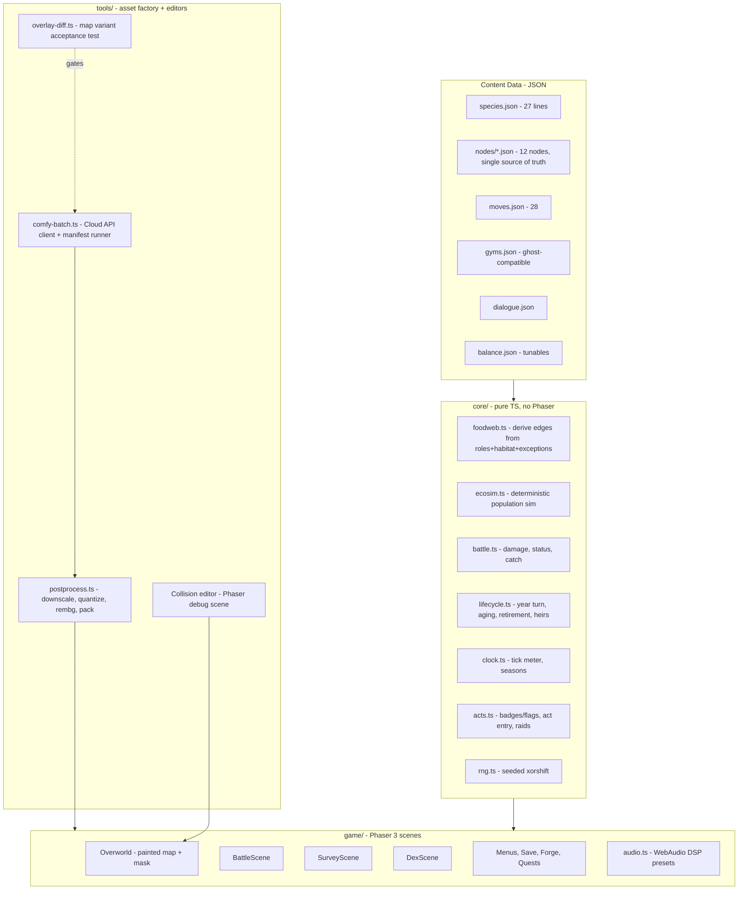

# TROPHIC — Build Doc v1.0

**Audience note (read first).** This document is canonical for all *decisions, schemas, formulas, pipeline, and build order*. `docs/content-bible.md` is canonical for all *content* (species tables, type chart, move pool, gym rosters, towns, quests, dialogue subjects, audio manifest). Where this doc inlines a formula or schema, the inlined version wins. Locked decisions are relitigated only by Hank overriding his own lock, and the override is folded in here rather than logged elsewhere.

**Where a reason lives.** A reason that must not be lost belongs in a **code comment on the line it constrains** — that is where it is read when someone edits it. A rule that constrains the project belongs in **this document**, as a rule, with no id and no history. What is open, in flight, or waiting on Hank belongs in `docs/STATUS.md`. There is no deviations ledger; git holds the history.

## 1. Mission & Effort Allocation

Trophic is a 2D Pokémon-Gold-style monster-catching RPG in which the region is a living ecosystem: catching decrements real per-node populations, over-catching cascades through a derived food web, and time advances on its own — ageing every creature, map, and town — whether or not the player is making progress. Two independent clocks run it (§3 L8, §4): the **calendar**, which is unbounded, and the **acts**, which carry the story. A fast player reaches the Sanctum with young creatures; a slow player reaches the same content having buried two generations. Both see the whole story, and the difference is written in the survey.

**Judged output: demo video + AI interview.** There is no hidden rubric beyond these, so effort allocates to what the video shows and the interview probes:

- **~40% — the two demo beats** (never-cut): (1) *Cascade*: hammer a prey species in year 1; open year 2 with its predator gone, a new apex risen, and the aged map. (2) *Legacy*: starter retires before the league; its heir fights the finale.
- **~25% — vertical slice walkability**: Hearthollow → R1 → Brackwater → R2 as painted walkable maps with encounters, battles, catching, survey.
- **~20% — deterministic core + tests**: battle engine, ecology sim, aging — headless, property-tested, harness-tunable. This is the interview ammunition.
- **~15% — everything else** (remaining nodes as vignettes, audio, dex, polish), all cut-safe.

Demo/UI polish is graded here (the video *is* the deliverable), so polish on the two demo beats outranks polish anywhere else.

## 2. Hard Requirements (non-negotiable)

1. All gameplay art is AI-generated via the validated Comfy Cloud pipeline (§9.3); all code agent-built.
2. Catching decrements the real population of that species at that node; the in-game survey shows real numbers, never proxies.
3. One JSON file per node is simultaneously: encounter table source, ecology-sim state, and bait lookup. No second table may exist (guardrail G3).
4. Everything ages at year turns, including boxed creatures. Sole exception: caught Ancients. Ageing is the CALENDAR's job and is untouched by the act model; the year turn fires on the full meter only (§3 L8).
5. Year-variant maps are img2img with layout frozen: **one collision mask per map survives all six years**, enforced by the overlay-diff acceptance test (§8.2).
6. Season variation is a runtime tint shader; year variation is art. Never generate seasonal map art.
7. Vellsire finale: catchable with honest costs — catch removes the keystone buff and the epilogue survey shows the numbers; release = restoration ending. No moralizing text anywhere; the counts are reported plainly and nothing comments on them.
8. Battle content exactly per bible: 8 types + Predation rule, 5 stats, 28-move pool, 4 statuses, levels 1–40, damage formula §7.4, KO = faint only.
9. Gym roster sizes are **3/4/5/6/6/6** and leader slots use the ghost-compatible schema (§7.7), but no ghost-team feature is built. `core/schemas.ts` `GYM_ROSTER_SIZES` hard-fails boot on any other shape. **Gym 1 only:** Maribel fields three, not the bible's four — the duplicate Nibbin (A) slot is cut, she keeps Bramblehog (A), Skir (A) and the signature "Old Nib" Nibbin (E), and her signature premium is **+0**, not +2. Authorised by Hank on a 500-seed measurement that gym 1 was the hardest fight in the game (26.0% against this doc's own §10.5 target of 80–95%). Bible §7 still prints 4/4/5/6/6/6; this doc wins.
10. Seasonal spawns v1-lite: exactly 4 migrants (Pollywisp/Reedrick/Gloomoth/Wispurr); dex + sign cards flag them dormant/migrating out of season.
11. Audio: single CC0 chiptune pack family curated against bible §12a; procedural SFX; DSP season presets + progressive year darkening. Retirement cue chosen first.
12. Web-deployable build (static hosting) — the demo must run from a URL or `npm run preview`.

## 3. Locked Decisions

| # | Decision | Choice | Rationale (one line) |
|---|---|---|---|
| L1 | Name | **Trophic** | Workshopped and confirmed; region stays Fallowmere. |
| L2 | Engine/stack | **Phaser 3 + TypeScript + Vite** | Painted-map+mask is image+bitmap; max agent training coverage; frictionless web demo. |
| L3 | Art platform | **Comfy Cloud API** (paid tier confirmed) | Official API, compatible with local ComfyUI API; SDK batch scripting. |
| L4 | Art model/settings | z_image_turbo, 8 steps, cfg 1.0, res_multistep/simple, 1024², fixed seed per asset | Validated by live trials; template skeleton is the style lock. |
| L5 | Walk cycle | **Comfy reference-guided (img2img) trial first**, acceptance bar §9.6; **procedural bob is the committed fallback** | User call: try it properly, bounded; bob is proven-acceptable. |
| L6 | Player sprite | Green shirt, ranger cap w/ star badge, leather satchel, walking boots, **no cape**. Finalization gate (§15 B0) precedes all multi-version generation | Explicit review lock + user wants one more iteration pass first. |
| L7 | Map structure | Node graph; each node a whole painted map + collision mask; no tilesets | Locked in ideation; vertical slice walkable, rest vignette-fallback. |
| L8 | Time | 16-tick season meter; travel 1 / foray 1 / inn 2; **year = full meter, and nothing else**. The calendar is **unbounded** and independent of story progress. | Locked, then **amended by Hank overriding his own lock**: a gym victory no longer ends a year (it cost a winning player the rest of that year's ticks), `isOver()` and the six-year cap are gone, and there is no fail state. `balance.clock.yearsTotal` = 6 is *expected pacing*, never a limit. |
| L9 | Aging/evolution | J3/A2/E1 lifespans; ×0.75/1.0/1.15; hybrid metamorphic model; heir-or-boon retirement | Locked. |
| L10 | Sim | Deterministic, seeded; pure function of (initial state, action log) | Enables replay, tests, and the balance harness for free. |
| L11 | Core code | Engine-agnostic pure TS in `/core`, zero Phaser imports | Balance harness and tests import the same module the game runs. |
| L12 | Save | Versioned JSON in localStorage, 3 slots | Zero backend; sufficient for demo. |
| L13 | Balance harness | Headless autobattler in-scope (§10.5) | Overnight tuning of §1–§3 constants is how numbers get honest. |

**The two-clock rule (amends L8; binds `core/`, `game/` and `tools/`).** TROPHIC has two clocks and **neither drives the other**:

- The **CALENDAR** — ticks → seasons → years. Unbounded, no cap, no fail state. It drives aging, retirement, boxed aging, the ecosim season step, season tint and year-variant art.
- The **ACTS** — badges and quest flags, never time (`core/acts.ts`). They drive town and route unlocks, story beats, Cullbrand raids, rival encounters and the finale. The run ends on an act condition (`runIsComplete`) and on nothing else.

A year turn moves no act; no act moves a tick; a gym victory costs no tick. Any field named for one axis is read as that axis only: `data/gyms.json` `act` is a story rung, and a harness must **choose** a pacing model rather than inherit one from the other clock.

## 4. Architecture



**Runtime narrative (one frame of play):**
1. Boot loads `balance.json`, all content JSON, and the save (or seeds a new one: RNG seed + copies of every node JSON as live sim state).
2. Overworld renders the node's painted map image, plus its year variant if `year > 1` and the variant passed overlay-diff. Movement queries the collision mask grid (§7.6). Season tint shader applies from `clock.season`.
3. A foray step rolls encounters: weights are **live population counts** from the node state (dead species literally stop appearing). Migrants filtered by season.
4. Battle runs entirely in `core/battle.ts` off a serialized `BattleInput`; the Phaser scene is a renderer of its event log. Catch success moves one individual from node population to party/box.
5. Ticks accrue (travel/foray/inn). At each season boundary `ecosim.step()` runs the population update (§7.3). At the full meter — **and at nothing else** — the **year turn** runs: festival, aging of every owned+boxed creature, retirement flow for expiring creatures, map variant swap, town aging arcs. The calendar never waits and never ends.
   - **One season step per season, exactly.** `core/clock.ts` emits **no** `seasonBoundary` on the tick that fills the year; that year's fourth step belongs to `runYearTurn`. Stepping on both cues runs five seasons a year and inflates every six-year trajectory by 25%.
5a. **The second clock (§3, `core/acts.ts`).** An act advances when its `balance.acts.gates` row is satisfied; entering an act fires that act's **event scripts (Cullbrand raids)**, unlocks its towns and routes, and carries its story beats, rival encounter and — at the last act — the finale.
6. Survey scene renders the node JSON's live numbers + the derived web graph. The epilogue reuses the same renderer over the final state — the ending is a survey read.

## 5. Repo Layout

```
trophic/
├── docs/                         # five files, and five is the budget
│   ├── build-doc.md              # this file — decisions, schemas, pipeline, build order
│   ├── content-bible.md          # canonical content (checked in verbatim)
│   ├── STATUS.md                 # the living doc: built / open / next / waiting on Hank
│   ├── CAST-AND-VOICE.md         # the prose standard
│   └── README.md                 # which document answers which question
├── data/                         # all JSON content (§7)
│   ├── species.json  moves.json  gyms.json  dialogue.json  balance.json
│   ├── palette.json              # frozen 32-color project palette (+ palette.candidate.json)
│   └── nodes/  (hearthollow.json, r1.json, brackwater.json, r2.json, …)
├── core/                         # pure TS, zero engine imports (L11)
├── game/                         # Phaser scenes, boot, audio
├── tools/
│   ├── comfy/                    # API client, workflow_api.json exports, manifest
│   ├── postprocess/  palette/  prose/
│   ├── collision-editor/         # runs as a Vite dev target
│   ├── overlay-diff/
│   ├── harness/                  # balance autobattler (imports core/)
│   └── sync-assets.mjs           # wired as predev/prebuild
├── tests/  gates/ unit/ property/ integration/
├── assets/
│   ├── raw/                      # Comfy outputs (gitignored except manifest)
│   ├── final/                    # post-processed, packed, committed
│   └── audio/  (+ ATTRIBUTION.md if CC-BY)
├── public/  index.html  vite.config.ts  package.json  .env.example
```

## 6. Config & Secrets

`.env.example` (never commit `.env`):
```
COMFY_CLOUD_API_KEY=comfyui-xxxxxxxxxxxx     # paid tier; API + UI share one credit pool
COMFY_HOST=https://cloud.comfy.org
```
API docs: https://docs.comfy.org/development/cloud/overview (Cloud API is compatible with the local ComfyUI API; use the official SDK or raw HTTP).

`data/balance.json` holds every tunable named in §7 (multipliers, breed/starve rates, catch constants, XP curve, encounter rates, thresholds). **Invariants, each backed by a named test:**
- **INV-1** Adding a species touches `species.json`, one node JSON, and assets only — no code. Test `ext_add_species`.
- **INV-2** Adding a node touches `data/nodes/` + assets + graph adjacency only. Test `ext_add_node`.
- **INV-3** Retuning balance touches `balance.json` only. Test `ext_retune` (harness runs with an overridden file). Two mechanical rules make that true rather than hoped:
  - **A key must be declared in BOTH `Balance` (`core/types.ts`) AND `zBalance` (`core/schemas.ts`) or it is silently stripped** — zod's `z.object` drops unknown keys, so an undeclared key turns `balance.json` into a decoy and every retune of it is ignored with no error. Gated by `tests/gates/schemas.test.ts` `balance_keys_survive_validation`. Every lane that adds a tunable owes both declarations.
  - **One tunable, one home.** A duplicated tunable is worse than a literal, because retuning it *looks* applied. `stats.boonModPct` and `encounter.scavengerRecentDeathsDivisor` are the survivors; `retirement.boonStatPct`, `status.applyChanceLightMove` and `ecosim.recentDeathsDivisor` were deleted as second copies and must not come back.
- **INV-4** No gameplay constant may be a literal in code; all read from `balance.json`. Test `no_magic_numbers` (lint rule / grep gate). Reciprocally (`balance.json` `_singleSource`): **no number in `balance.json` may also be written anywhere else in `data/`** — one number, one home, with the owning document deciding which copy survives.

## 7. Data Models (fully typed)

All content is TypeScript-typed via `core/types.ts`; JSON files are validated against these at boot with zod (fail loud on drift).

### 7.1 Species (`species.json`) — 27 lines
```ts
type TypeName = "Beast"|"Fire"|"Water"|"Plant"|"Earth"|"Wind"|"Poison"|"Dark";
type Role = "Producer"|"Grazer"|"Mesopredator"|"Apex"|"Scavenger"|"AncientApex";
type AgeClass = "J"|"A"|"E";
type Season = "spring"|"summer"|"autumn"|"winter";

interface SpeciesLine {
  id: string;                     // "mirefin-line"
  dexIds: string[];               // named identities for dex art (35 total incl. age names)
  formNames: Record<AgeClass,string>;   // e.g. {J:"Bogling", A:"Mirefin", E:"Mirefin"}
  types: Record<AgeClass, TypeName[]>;  // per-age (metamorphic lines shift here)
  role: Record<AgeClass, Role>;         // per-age (Bogling Grazer -> Mirefin Mesopredator)
  habitat: string[];              // node biome tags; "roaming" = all
  baseStats: {hp:number; atk:number; def:number; spd:number; ins:number}; // 30–100
  metamorphic: boolean;           // true => ×1.15 extra on J->A transition
  ancient: boolean;               // never ages, always E, exempt from year turns
  seasonalWindow?: Season;        // only the 4 migrants have this
  movePool: {type1:string; type2:string; role:string; utility:string}; // ids into moves.json, unlock 1/5/10/15
  dietExceptions?: string[];      // extra prey line-ids (Fenmaw -> Reedrick)
  presenceEffect?: "keystoneBreed"|"ventWarmth"|"waterTable"; // Ancients only
}
```
Content values come verbatim from bible §4; the agent transcribes, never invents. **27 entries = 24 aging lines + 3 Ancients** (`ancient:true`: Vellsire, Kilnback, Undermere). Every non-Ancient line spends exactly 300 base-stat points, so base-stat total measures allocation, not quality.

### 7.2 Node (`data/nodes/*.json`) — THE chokepoint schema
```ts
interface NodeFile {
  id: string; name: string; biome: string;
  adjacency: string[];            // node graph edges
  walkable: boolean;              // false => vignette card fallback
  mapAsset: string;               // base painted map
  yearVariants: Partial<Record<2|3|4|5|6,string>>; // only overlay-diff-passed variants listed
  collisionMask: string;          // ONE per node, all years (Hard Req 5)
  floraStock: number;             // abstract producer stock, 0–100
  populations: Record<string,{   // key = species line id
    count: number;                // integer individuals; survey shows THIS number
    breedRate: number;            // per-season fractional growth
    carryCap: number;
  }>;
  props: PropPlacement[];         // antler stones, shrines, idols — sign-chain trailheads
  spawnTables?: never;            // OPTIONAL and untyped: encounter weights are DERIVED (G3).
                                  // A *required* `never` is uninhabitable — no object could satisfy NodeFile.
}
```
**Derivations (never stored):** encounter weight of species s = `populations[s].count` (0 count = 0 encounters — the cascade is visible for free), filtered by `seasonalWindow`, Scavenger weight × `(1 + recentDeaths / balance.encounter.scavengerRecentDeathsDivisor)`. Bait lookup: bait matches target if bait's tag ∈ target's derived diet (7.3). Sim initial state = the file as shipped.

**Encounter level is indexed by the ACT, not the calendar year.** `balance.encounter.levelByYear` keeps its shipped name but both readers — `game/encounters.ts` `rollLevel` and `tools/harness/player.ts` — index it by act; a year-indexed reading puts a player still in act 1 against level 34–38 wild creatures by calendar year 6. Retuning it must keep it **exactly two levels under the gym rank-and-file ramp** in `data/gyms.json`; `tests/unit/transcription.test.ts` binds the two, so retuning one alone goes red.

### 7.3 Food Web Derivation + Population Step (`core/foodweb.ts`, `core/ecosim.ts`)
Edges derived per node, per bible §5: Apex eats {Mesopredator, large Grazer} in habitat; Mesopredator eats Grazers; Grazers eat Producers + floraStock; Scavengers eat nothing live; plus each species' `dietExceptions`; Ancients eat nothing (presence effects instead).

`ecosim.step(node, season, rng)` — runs at every season boundary, numbered:
1. `births[s] = count[s] × breedRate[s] × foodFactor(s) × presenceMult(s)` — foodFactor = clamp(availablePrey / demand, 0.25, 1.25); presenceMult per Ancient effects (Vellsire adjacent-node breeding ×1.5 while free; Kilnback: Fire spawns active; Undermere: Water breedRate floor).
2. `starvation[s]`: if availablePrey/demand < `balance.starveThreshold` (default 0.4), deaths = count × `starveRate` (default 0.3).
3. Predation transfer: each predator consumes `predationDraw` (default 0.1 × predatorCount) from prey pools, proportionally across its prey.
4. Clamp to [0, carryCap]; round via seeded RNG (stochastic rounding so small populations can die out or recover — determinism preserved by seed).
5. `recentDeaths` accumulator updates (drives Carricrow weight).
6. **Cascade emergence check (not scripted):** these rules alone must produce mesopredator-release when an apex's prey is over-caught. Verified by test `cascade_emerges` (§10.2), not by special-case code. DO NOT hard-code the demo cascade (G6).

All constants live in `balance.json`. Player catch/release directly increments/decrements `count` at action time — **through `core/ecosim.ts`, which owns the clamp**. There is exactly one implementation of a population write: the live path (`game/wild-battle.ts`, `game/boot.ts`, `game/survey-view.ts`) and `core/save.ts` `replay` must move a count identically, clamps included, or L10's byte-identical-replay claim is false.

### 7.4 Battle (`core/battle.ts`)
- Effective stat = `base × ageMult × (1 + 0.02 × level) + traitMods` (ageMult .75/1.0/1.15; metamorphic J→A adds ×1.15 once).
- `damage = (atk × movePower / def) × typeMult × predation × roll(0.9,1.1)`; typeMult from bible §1 chart transcribed into `moves.json`; predation = 1.25 if attacker's derived diet includes defender's line.
- Statuses (4): Burn 6%/turn chip; Toxin 4% ramping +2%/turn; Soak −30% Speed; Daze 25% skip. One status at a time, newest wins.
- **Catch formula (build-doc addition, tunable):** `p = baseCatch(age) × snareTier × (baitMult × instinctBait(catcher)) × (2 − hpFrac) / 2 × lureMult`, with baseCatch J .5 / A .3 / E .15 (Ancients .05), snareTier 1/1.5/2.2, baitMult 1.5 diet-match role bait / 2.0 species bait, lure ×1.5. Clamp .02–.95.
  - The **Instinct term** is bible §2's second job for Instinct ("bait success"): `instinctBait(c) = 1 + instinctBaitSlope × (insShare(c) − instinctBaitPivot)`, where `insShare(c) = c.ins / (c.hp + c.atk + c.def + c.spd + c.ins)` over the CATCHING creature's effective stats (traits and boons included; in-battle stat mods excluded). Shipped pivot .15, slope 3, both in `balance.catch` (G11). A catch with no named catcher takes the pivot, i.e. `instinctBait = 1`.
  - It reads the **allocation**, not the raw stat — every non-Ancient line spends 300 base points, and age/level/metamorphic/Beast cancel out of the ratio — so it rebalances *who* catches well and never becomes a catch rate that climbs with the player's level. It is continuous, strictly increasing in Instinct and positive over the whole share range, so `.02–.95` remains the only clamp.
- **XP (build-doc addition, tunable):** `xpGain = 12 + 4×enemyLevel × ageBonus(E:1.3)`; `xpToNext(l) = 15 × l^1.4`. Cap level 40.
- Flee: `pFlee = 0.4 + 0.4 × (mySpd/theirSpd)`, clamp .1–.95.
- Battle is a pure reducer: `(BattleState, Action, rng) => {state, events[]}`. The Phaser scene replays `events[]`. Test surface = feed action scripts headless.

### 7.5 Party, Aging, Retirement (`core/lifecycle.ts`)
```ts
interface OwnedCreature {
  uid: string; lineId: string; age: AgeClass; level: number;
  caughtYear: number; yearsRemaining: number;   // J:3 A:2 E:1 at catch
  traits: Trait[];  relicSlot?: string;  boons: Boon[];
  projectedRetirementYear: number;              // displayed on card (Hard Req from bible)
}
```
Year turn, numbered: (1) every owned + boxed non-Ancient creature: `yearsRemaining--`, age class advances J→A→E on its schedule; (2) metamorphic transitions apply name/type/role/stat-jump; (3) any creature at 0 → **retirement flow**: player chooses HEIR (new J of same line, level = floor(parent × `balance.retirement.heirLevelFactor`), inherits 1–2 randomly chosen parent traits + parent's relic slot unlocked) or BOON (chosen teammate gains permanent +`stats.boonModPct` to one stat, named after the retiree); (4) Ancients skipped; (5) node sims run their 4th season step; (6) map year-variant swap if present.

**Raids are on the act clock, never the calendar.** `balance.yearEvents.raids` is keyed by `act` and applied by `core/lifecycle.ts` `enterPendingActs` on entry to that act. **A year turn emits no raid event, ever.** What a raid takes is a **strip harvest**: `max(authored remove, round(count × balance.yearEvents.harvestFractionOfStanding))`. The authored `targets[].remove` was written against shipped counts, and a node breeds toward `carryCap` while the player is elsewhere, so the authored figure alone stops being a strip the later it fires. `game/year-events.ts` `raidPreviews` reports the same number the sim will take.

**Regional events are season-long windows.** Each of bible §9's four events opens on a season boundary and lasts exactly `balance.clock.ticksPerSeason` ticks (`core/regional-events.ts`). Two are DERIVED (Festival = the year's final season; Great Migration = the migrant's own `seasonalWindow`) and two are LATCHED (Bloom Year latches on the *rise* across the flora threshold; Cullbrand raid latches on act entry) — because a window must be able to **close while its opening condition is still true**, or it is a state and not an event.

**Step 6 resolves through §9.5's fallback, not an exact-year lookup.** `yearVariants` only ever holds keys 2–6 and the calendar is unbounded, so `mapAssetForYear` resolves **downward** to the nearest passing variant and the turn reports a swap when the RESOLVED asset changes. A year-9 Hearthollow renders as year-6 Hearthollow, never as the base map.

### 7.6 Maps & Collision
Virtual resolution 480×320, integer-scaled. Painted maps 1024×1024 native rendered 2× (2048² world). Collision mask: 1-bit PNG at map native res, sampled on a 16px grid (64×64 cells) into a packed bitfield at build time. Player logical sprite 32×48, tile step 32px, grid movement Gold-style. Props are entries in `props[]` with interaction radius, not baked into collision (they overlay the painted map).

### 7.7 Gyms (`gyms.json`) — ghost-compatible schema
```ts
interface GymTeamSlot { lineId:string; age:AgeClass; level:number; traits?:Trait[]; nickname?:string; }
interface GymLeader { id:string; name:string; act:number; town:string; type:TypeName|"mixed"; slots:GymTeamSlot[]; signature:GymTeamSlot; source:"fixed"|"ghost"; }
```
`act` is bible §7's leftmost column, which the bible labels "Yr". It is an **act index and not a calendar year** — the field is named `act` in the schema and in the data so nothing re-conflates the two clocks. All six ship with `source:"fixed"`, rosters transcribed from bible §7 at the §2 Hard Req 9 sizes. `"ghost"` is schema-only; building any ghost feature is guardrail G8.

### 7.8 Save
`{version, seed, year, tick, currentNode, party[], box[], money, items, questFlags, nodeStates (full NodeFile.populations+floraStock per node), actionLog[]}` — localStorage, 3 slots. `version` is **read from `balance.party.saveVersion`** (currently **2**), never a literal — `core/types.ts` declares `version: number` and `core/save.ts` resolves it through `saveVersionOf(balance)`. `nodeStates` is the live sim; `actionLog` enables deterministic replay (L10). Migration: refuse older versions with a clear message (demo scope).

## 8. Cross-Cutting Load-Bearing Specs

### 8.1 Determinism (→ tests `det_replay`, `det_sim`)
One seeded xorshift128 stream per subsystem (battle, sim, encounters), seeds derived from save seed + subsystem tag. Property: identical (seed, actionLog) ⇒ byte-identical final save. No `Math.random` anywhere (lint gate). Two draw-order rules the replay depends on:

- **Region stepping costs the parent RNG one draw per STEP, not per node.** This is what makes INV-2 true — adding a node must not shift every later draw — and it is why `game/year-replay.ts` exists rather than a per-node hook inside `replay`. Measured divergence with a per-node hook: 17 counts across 6 nodes after one year turn.
- **A retirement prompt whose offered choice AND rolled-heir fallback are both illegal is skipped BEFORE the heir is rolled.** `core/save.ts` `replay` draws `rollHeirChoice` only inside its `retirement` case, so rolling for a prompt that is then skipped leaves the live stream one draw ahead of its own replay.

### 8.2 Map-variant layout freeze (→ test `overlay_diff`, gates the art lane)
`tools/overlay-diff`. **Two criteria, both binding**; a candidate must clear both.
1. Threshold both base map and candidate year variant to walkability-relevant edges (Sobel on luminance), dilate 2px, compute IoU of edge maps **restricted to the walkable cells of the collision mask**. Accept iff IoU ≥ `balance.overlayDiff.iouThreshold` (0.85).
2. **No drifted region large enough to matter.** The same IoU per collision cell; cells under threshold are grouped into 8-connected regions; a region fails if it holds as many judged cells as the player's own footprint (`balance.overlayDiff.driftFootprintCells`, 2×3) **or** if the base edge pixels LOST inside it reach `driftLimit × (2·dilatePx+1)²`. Criterion 1 alone is arithmetically incapable of failing on a local change — displacing a fraction f of edge pixels gives IoU ≈ (1−f)/(1+f), which clears 0.85 for every f ≤ 0.081 — and img2img at denoise 0.35 does not translate the frame, it re-imagines regions.

Honest limit, pinned in `tests/unit/overlay-diff.test.ts` so a retune cannot move it in silence: the gate catches a displaced object at player scale and above (a 64px feature displaced one cell is rejected 25 of 25), and **does not** reliably catch one below it (a 32px feature is still accepted at 8 of the same 25 pairs). A failing variant is regenerated at lower denoise (start 0.35, step −0.05, floor 0.2); a REJECT is never overridden by hand (G4).

### 8.3 Single-source-of-truth (→ test `no_shadow_tables`)
Grep/AST gate: no file other than `core/foodweb.ts` may compute diet edges; no encounter-weight literal tables anywhere; survey UI reads `nodeStates` objects directly. **No species id and no role name may appear in any file under `tools/`** (enforced by `tests/property/foodweb.test.ts`) — a harness that names a species has an opinion about the web, which is the G2/G3 failure in its most convincing disguise.

### 8.4 Style lock (art)
Every generation uses the L4 settings + the template skeleton verbatim (§9.2) + the frozen negative prompt + a fixed per-asset seed recorded in the manifest. Post-process quantizes to `palette.json`. Any asset regenerated must reuse its manifest seed unless the manifest entry is versioned.

**The palette contract is positional, not chromatic.** The stable thing every downstream consumer indexes against is the **32 positional swatch ids `c00`…`c31`**, the count, and the truth of the `frozen`/`frozenAt` pair (`core/schemas.ts`). The hex values are a gate-B0 value swap and are pinned nowhere: freezing the palette from the approved trial set rewrites hexes at fixed ids, and nothing may key off a hex.

### 8.5 Authored-content reachability (→ gates `tests/gates/reachability.test.ts`, `tests/gates/quest-layer.test.ts`)
**"Authored content must be reachable" is an enforced architectural guarantee, not a hope** — it exists because a fully green suite once certified a large fraction of the dialogue corpus, including both epilogues, as shipped when the player could not reach it. The invariant is three clauses: **(a)** every flag any entry's `when` requires has a writer outside the tests; **(b)** every kind in `DIALOGUE_KINDS` has a selector in `game/`, and every `(fighter, node)` pair a selector can be called with answers all three battle kinds; **(c)** every authored entry has a path to the screen, including through `flagEquals` *values*.

The load-bearing design decision is **how a "writer" is established, because a grep in either direction is wrong.** Grepping for the flag key misses `game/quests.ts`, which builds keys from constants and derives others from the corpus. Grepping for a *mention* is worse: every one of these keys is discussed at length in comments, so a mention-based census certifies a flag as written by three modules that only talk about it. The census therefore has four sources — **CORPUS** (the real `flagsWritten`), **DERIVED** (expanders calling the real exported constructors over the real shipped domains, so a moved constant moves the expansion), **OBSERVED** (flags that appear on a save after *driving* the real writers — not "a writer exists" but "the flag appeared"), and **LITERAL** (flag-shaped strings in comment-stripped shipping source; weak, and any flag resting on it alone must be named in a reviewed list, which is empty).

**A precondition is only real if something outside the test produces it.** §8.1–§8.3 prove the *systems* are correct; this proves the *content* is connected to them.

## 9. Asset Factory (tools/comfy)

### 9.1 Pipeline shape
Scripted batch via the official Cloud API. The validated trial graph is exported once as **API-format workflow JSON** per asset class; `comfy-batch.ts` loads `manifest.json`, injects `{prompt, seed, denoise, init_image}` per row, submits, collects, downloads to `assets/raw/<class>/<assetId>.png`, and records `{assetId, seed, workflowHash, timestamp}` back into the manifest. Concurrency: respect tier limit; retry ×2 on failure then flag for supervised review.

**Transport rules — Comfy Cloud is not local ComfyUI** (binds `client.ts`, `comfy-batch.ts`, `img2img.ts`, `player-views.ts`, `b0-views.ts`):
- Cloud does **not** implement `GET /api/history/{id}`. Job outputs arrive **only** over the WebSocket `executed` message while the job runs, and a job can finish in ~3s — so **the socket must be OPEN BEFORE the prompt is submitted**, or the output is unrecoverable and the job still bills.
- `GET /api/job/{id}/status` is authoritative for terminal state but carries **no outputs**.
- **Cloud bills for FAILED jobs.** No test may touch the network, ever.
- Cloud exposes **no credit-balance endpoint** (`/api/customers/credit`, `/api/credit`, `/api/user/credit` all 404). G13's pre-batch estimate is therefore a **measured** per-image figure or it is nothing: the runner says "never measured" rather than inventing a number. Credits are shared with the UI pool; any batch ≥ 20 items requires `--confirm` (SUPERVISED).

### 9.2 Locked generation parameters (verbatim)
- Model `Comfy-Org/z_image_turbo` + its CLIP lumina2 + Comfy-Org VAE (stock cloud txt2img graph). 8 steps, cfg 1.0, sampler `res_multistep`, scheduler `simple`, 1024×1024, fixed seed per manifest row.
- **`ModelSamplingAuraFlow` with `shift: 3`, feeding the KSampler.** It is in the validated trial graph and it materially affects the output; it is part of the locked parameter list, not an incidental node.
- **Seed pin: the validated trial seed is `42`.** (A "62" in the original handoff is the CLIPLoader's *node id*, not a seed.) Pinned in `manifest.json` `_player.seedPin`, `manifest-b0.json`, `manifest-palette.json`, `player-views.ts`, `b0-views.ts`, `b0-sweep.ts`, and load-bearing for G5 and the B1 reproduction gate.
- Negative prompt (all classes): `low quality, bad anatomy, extra digits, missing digits, extra limbs, missing limbs`
- Template skeleton (style lock): `pixel art [ASSET CLASS], retro 90s handheld monster-taming RPG style, [SUBJECT DESCRIPTION], [VIEW/POSE], full body, centered composition, plain white background, [PALETTE NOTE], crisp clean pixel edges, 2D game asset`
- Class variants (proven): creature battle sprite · trainer battle sprite · overworld character sprite (add `small chibi proportions`) · top-down town map (add `three-quarter overhead view, entire town visible, no characters` + `wide walkable paths, spacious layout, clear building entrances`).
- **Fidelity rule — name distinctive anatomy by its SHAPE, never by its species term.** This model reads a specialist term as its common relative, so front-loading and repeating the term repeats the wrong animal (Fenmaw's gharial snout class of failure): describe the long narrow snout, not the gharial. Accept partial pose adherence; don't over-engineer. **G2 boundary:** rewriting the PROMPT is not rewriting the creature — but a term that fixes no anatomy (e.g. "vent basilisk") is left alone rather than invented into one.
- Player character (L6, verbatim in every player prompt): `green shirt, ranger cap with star badge, leather satchel, walking boots` — never `cape` or `cloak`.

### 9.3 Post-process chain (`tools/postprocess`, required — raw output is pixel-style, not grid-aligned)
Per sprite: (1) nearest-neighbor downscale to target (battle 96², overworld chars 32×48, minis 32²); (2) quantize to `palette.json`; (3) rembg background removal; (4) pack to sprite atlases. Maps: downscale to 1024² retained, quantize, **no rembg**. Every step idempotent and re-runnable from `raw/`.

**`backgroundTolerance` is a property of the PALETTE, not of the removal step.** Step 3 runs after quantize, so the tolerance must match the palette's *image* of white. No file under `tools/` may name a background-tolerance literal (G11, bound by `tests/unit/postprocess.test.ts`); every caller of `trimBackground` / `removeFlatBackground` resolves through `backgroundForClass`.

### 9.4 Untrialed class gate — painted dex illustration
First task of the batch phase (build order B2): a SUPERVISED trial of the painted (non-pixel) dex class. Prompt direction: `painted storybook illustration, natural-history field-guide style, [SUBJECT], soft watercolor texture, muted palette` — iterate to approval before generating the 35. If it can't reach approval in one supervised loop, cut line C4 applies (dex falls back to upscaled pixel sprites on parchment frames) — the game must not block on it.

### 9.5 Aged map variants
img2img on the approved base map, denoise start 0.35, prompt appends the node's aging arc (bible §6: "docks rot", "canopy thins", "vents flare", …), layout frozen; every candidate runs `overlay-diff` (§8.2) before entering the node JSON. Budget: ≤ 3 regen attempts per variant, then that year reuses the nearest passing variant (visual continuity beats variant count).

**Spec limit — img2img on this model is for deltas WITHIN a view and cannot turn one.** Identity drift begins at a lower denoise than view rotation does, so there is no denoise that rotates a subject while holding its identity. A new view must be *derived*, or generated and re-approved as a new identity. This binds §9.6 too: its denoise sweep is sound for a walk frame and does not generalise to a view change.

### 9.6 Walk-cycle trial (L5) — spec
Precondition: gate B0 (player sprite finalized) passed. SUPERVISED, timeboxed to one review loop (~12–16 generations):
1. Inputs: approved player front/back/side statics.
2. Method: img2img per frame with the matching static as init, denoise sweep {0.3, 0.4, 0.5}, prompt appends `mid-step, left foot forward` / `right foot forward`; side frames mirrored for the 4th direction.
3. **Acceptance bar (all required):** cap, satchel, shirt color pixel-stable across frames after quantize; silhouette delta confined to legs/arms (diff mask below torso midline ≥ 90% of changed pixels); reads as a walk at 8 fps in the collision-editor preview.
4. Pass ⇒ pack 4-dir × 3-frame sheet. Fail ⇒ **fall to bob without discussion**: y = 2px sine per tile step, 1px lateral sway, horizontal flip alternation. Bob ships in either case as the NPC animation (NPCs are turn-to-face statics regardless).

### 9.7 Asset manifest (counts)
Derived from the shipped roster, not from the bible's arithmetic: **24 aging lines × 3 forms + 3 Ancients × 1 form = 75 forms ⇒ 150 battle sprites** (front/back). (Bible §4 and its "77 forms / 154 sprites" predate the third Ancient; this doc wins, and `manifest.test.ts` and `battle-view.test.ts` bind 150.) Plus: 35 painted dex identities (gated §9.4) · 12 base maps + up to 30 accepted year variants (only vertical-slice nodes guaranteed variants; others cut-safe) · overworld minis for encounterable species (~25) · 8 trainer battle sprites (5 leaders + Greaves + Wick + Maren) · ambient NPC statics (~12 reusable) · prop set (antler stones, shell-kiln shrines, sunken idols, sign-card frame) · UI frames · player statics + walk sheet (or bob). Manifest rows carry: id, class, subject string, view, seed, target size, status (pending/raw/final/approved).

## 10. Test Plan

Runner: vitest. Core suite must pass headless with no Phaser installed (proves L11).

1. **Unit:** damage formula table-driven against hand-computed cases incl. Predation and Beast +10%; status tick math; catch/flee clamps; XP curve; effective-stat incl. metamorphic jump.
2. **Property (fast-check):** `pop_bounds` populations always integer ∈ [0, carryCap]; `det_sim` same seed ⇒ same trajectory; `det_replay` (§8.1); `migrant_legibility` — out-of-season migrant never appears in encounters AND its dex flag reads dormant/migrating; and `cascade_emerges` — the demo beat as a law, not a script: forcing an Apex's prey to <10% for 2 consecutive seasons drives apex count → 0 and a mesopredator strictly rising within 4 seasons. Two readings of that statement are binding, and both are measured, because reporting only the flattering one is how a harness lies:
   - **"Its primary prey" (singular) is FALSE wherever a predator can substitute pools.** The binding reading is `limitingPrey` (`core/foodweb.ts`): the *minimal set* of catchable pools whose loss starves the predator.
   - **The release clause is MESOPREDATOR-ROLE-ONLY.** Counting released prey of any role publishes a rebounding Grazer as a mesopredator release — a two-tier collapse reported as its opposite. Binds `tools/harness/full-run.ts`, `fixture.ts`, `report.ts` and `tests/integration/demo-beats.test.ts`.
3. **Invariant gates:** INV-1..4 (§6), `no_shadow_tables` (§8.3), `no_magic_numbers`, no-`Math.random` lint, `balance_keys_survive_validation` (§6 INV-3).
4. **Pipeline tests:** `overlay_diff` self-test on synthetic pairs (translated layout must fail, texture-only change must pass); postprocess idempotency; manifest seed-reuse enforcement. No pipeline test touches the network (§9.1).
5. **Balance harness (`tools/harness`, L13):** headless autobattler importing `core/battle.ts`. Modes: (a) gym-sim — a scripted "reasonable player" party per act vs each gym roster, 500 seeds, report win rate (targets: gyms 1–2 ∈ [80,95]%, 3–4 ∈ [60,80]%, 5–6 ∈ [45,65]%); (b) type-chart round-robin — every line vs every line at equal level, flag any line with <35% or >65% aggregate winrate; (c) full-run sim — six years of scripted catching against the sim, assert no unintended extinction under normal play and guaranteed cascade under over-catch script. Output: markdown report + suggested `balance.json` deltas. Overnight loop: agent runs harness → adjusts `balance.json` only (INV-3) → reruns → commits report. The harness **chooses** its pacing model explicitly (§3, two clocks); it never infers one axis from the other.
6. **Acceptance tests per extensibility invariant** as named in §6.
7. **Reachability gates (`tests/gates/reachability.test.ts`, 33 cases) — §8.5's invariant, enforced.** Four gate families: *flag census* (every required flag has a writer established outside the tests; a failure names the orphan flag **and every entry it strands**); *selector coverage* (every `DIALOGUE_KINDS` kind is reached by `AUTOPLAY_KINDS` ∪ `BATTLE_KINDS` ∪ `TALK_KINDS` or structurally by `propId`, and every `(fighter, node)` pair a battle selector can be called with answers all three battle kinds); *entry reachability* (including entries killed by a `flagEquals` **value** nothing produces); and *non-flag satisfiability* (population / flora / season / year clauses checked by moving the real region, not by asserting over a frozen one).
8. **Quest-layer gate (`tests/gates/quest-layer.test.ts`, 21 cases).** The offer → accept → turn-in → done chain is closed in **both** directions (every role flag written *and* read); no quest's turn-in objective is a flag its own offer already requires; no turn-in comes due on a save that has done everything and spoken to nobody; a deadline the copy states is a deadline the objective has; the objective is the thing the copy describes; `syncQuestFlags` is idempotent. **There is no fixture quest table in the file** — the point of `core/quests.ts` is that the bill is *derived* from the corpus, so a fixture would only prove the fixture.

## 11. Fixtures
Synthetic only: `fixtures/mini-node.json` (3 species, tiny counts — hand-checkable sim math); `fixtures/battle-scripts/*.json` (action logs incl. gym fights); `fixtures/overcatch-script.json` (the demo cascade as an action log — used by tests AND by the demo-recording flow); stress fixture `fixtures/mega-node.json` (all 27 lines, counts ×100 — sim step must stay <5ms, §12).

## 12. Performance Notes
Modest, but tested: overworld 60fps at 480×320 integer scale (painted map is one static image + one sprite layer — trivially fine); `ecosim.step` all 12 nodes < 5ms (benchmark test `perf_sim` with margin ×4 on mega-node); battle reducer < 1ms/action; boot < 3s on broadband (atlas packing + lazy-load painted dex art). Save serialize < 50ms.

## 13. README / Interview Prep (write into repo README.md)
Sections: what it is (2 paragraphs + the two demo beats as GIFs), architecture diagram, "real numbers, no moralizing" design note, honest known-gaps list (§ `docs/STATUS.md` is the source for these). **Pre-written answers, full arguments, to the evaluation questions the AI interview will probe:**
- *How was AI used?* Full pipeline: agent-built code from this doc; all art via Comfy Cloud API batch (settings §9.2), style held by a locked prompt skeleton + frozen palette, zero LoRAs; balance tuned by an autonomous harness loop.
- *How do you know the ecology works?* It's a law, not a script: `cascade_emerges` property test; deterministic replay; the demo cascade is a recorded action log any reviewer can re-run.
- *Why no tilesets?* Whole-painted maps + one collision mask trade tile flexibility for AI-generatable art; the layout-freeze overlay-diff test is what makes six-year aging affordable.
- *What would break at scale?* Honest: JSON-in-localStorage saves, O(n²) web derivation fine at 27 lines, palette lock limits art variety.
- *What was cut and why* — filled from the cut-line record at submission time.

## 14. Dev Setup
```
npm i && cp .env.example .env    # add COMFY_CLOUD_API_KEY (asset work only; game runs without it)
npm run dev        # game at :5173   (predev/prebuild run tools/sync-assets.mjs)
npm run test       # full suite (no key, no Phaser needed for core tests)
npm run gates      # the two permanent reachability/quest gates (§8.5)
npm run typecheck  # tsc --noEmit; silence is clean
npm run harness    # balance report
npm run collision  # collision editor on :5174
npm run postprocess · npm run overlay-diff
npm run factory -- --manifest tools/comfy/manifest.json --class battle --confirm
npm run build && npm run preview
```
Node 20+. No Docker needed (static web build); optional `Dockerfile` is stretch S4.

## 15. Build Order (agentic lanes, acceptance gate per step — do not proceed past a gate with failing tests)

**SUPERVISED** means the step requires Hank's review via chat/Chrome extension before it proceeds; everything else runs unsupervised. Sizes are agentic-execution units, never human hours (G12).

**Gate B0 (SUPERVISED, first):** player-sprite finalization loop — iterate the main character statics with Hank until approved; freeze `palette.json` from the approved set. Nothing multi-version (walk trial, overworld batch) starts before B0.

**Lane A — core (unsupervised, parallel-safe):**
A1 types + zod schemas + content transcription from bible (species/moves/gyms/type chart) → gate: schemas validate, transcription spot-check test vs bible tables. A2 rng/clock/foodweb/ecosim + property tests → gate: §10.2 green incl. `cascade_emerges`. A3 battle reducer + unit suite. A4 lifecycle/year-turn + retirement. A5 harness + first overnight tuning loop.

**Lane B — asset factory (needs B0):**
B1 Cloud API client + manifest runner + postprocess on trial assets → gate: one asset per pixel class reproduced from manifest byte-identically. B2 painted-dex trial (SUPERVISED, §9.4). B3 battle-sprite batch (150) in class chunks with Chrome-extension review checkpoints every ~40. B4 vertical-slice maps (4) + collision masks via editor (SUPERVISED, ~1 review per map) + year-2 variants through overlay-diff. B5 walk-cycle trial (SUPERVISED, §9.6). B6 remaining maps/minis/props/UI.

**Lane C — game shell (parallel with A/B, placeholder art until B lands):**
C1 boot/save/menus. C2 overworld: painted map + mask movement + encounters off node JSON. C3 battle scene as event-log renderer. C4 survey + dex + summary (projected retirement year on card). C5 tick meter/seasons/tint shader. C6 year turn UX: festival, aging, retirement flow. C7 quests/dialogue/props/sign chains (vertical slice quests first: First Signs, Fallow Field, Restock the Shallows, Ferryman's Wager) + opening/tutorial beat (bible §13.15: 3–4 painted stills — ride the §9.4 painted-class trial, pixel-still fallback — + Maren dialogue; dialogue budget ~10 lines/named NPC, ~3/ambient per bible §13.13). C8 audio: pack curation (SUPERVISED — retirement cue first, bible §12a manifest), WebAudio DSP presets, procedural SFX. C9 remaining nodes as vignette cards + acts 3–6 story beats + finale/epilogue survey.

**Integration gates:** I1 vertical slice playable end-to-end (catch, battle, survey moves, year turn). I2 **cascade demo reproducible from `overcatch-script.json` in real play.** I3 **retirement/heir beat playable.** I4 finale + both endings + epilogue survey. I5 full test suite + harness targets green. I6 demo-video dry run.

**Cut lines (in order — cut from the bottom up):** C-1 acts 5–6 towns walkable → vignettes (already default). C-2 year variants beyond year 2 for non-slice nodes. C-3 side quests beyond the 4 slice quests. C-4 painted dex class (fallback §9.4). C-5 Kilnback/Undermere catch chains → lore-only. C-6 forge/relics UI → auto-apply relics. **Never cut:** the two demo beats, vertical-slice walkability, real-number survey, retirement flow, Vellsire choice + epilogue survey, determinism tests.

**Stretch (flagged, cut-safe):** S1 Retro Diffusion walk-sheet exploration (only if B5 fails AND schedule is ahead). S2 full per-species seasonal tables. S3 ghost gym ingestion of saved teams (schema exists). S4 Dockerfile. S5 Nuzlocke permadeath toggle.

## 16. Agent Guardrails — DO NOT
- G1 Do not build or generate tilesets, or slice painted maps into tiles.
- G2 Do not invent species, moves, types, statuses, towns, place names, organisation names, or roster changes — bible values verbatim; a discrepancy is raised for Hank, never fixed in passing.
- G3 Do not create any second encounter/spawn/bait table — all derived from node JSON (test-enforced).
- G4 Do not accept a map year-variant that hasn't passed both §8.2 criteria; do not hand-edit collision masks to fit a drifted variant; do not override a REJECT.
- G5 Do not regenerate an approved asset without reusing its manifest seed (or versioning the row).
- G6 Do not script the demo cascade into the sim — it must emerge from the §7.3 rules (the action-log fixture drives play, not the sim).
- G7 Do not write moralizing copy about catching anywhere. No line may tell the player they did wrong, imply guilt, or deliver a lesson. Populations are reported the way a working field biologist reports them — plainly, as counts, with no reverence for the notebook they are written in.
- G8 Do not build ghost-team features; schema only.
- G9 Do not mix audio packs or exceed one composer family; no CC-BY without ATTRIBUTION.md.
- G10 Do not skip year-turn aging for boxed creatures, and do not age caught Ancients.
- G11 Do not put gameplay constants in code (`balance.json` only) or use `Math.random`. This includes tool-side constants: no file under `tools/` may name a background-tolerance literal (§9.3).
- G12 Do not report effort in human engineering-hours anywhere (docs, comments, commits) — agentic-execution terms only.
- G13 Do not run a ≥20-item generation batch without the credit estimate + `--confirm` step, and do not invent the estimate — it is a measured per-image figure or the runner says "never measured" (§9.1).
- G14 Do not proceed past a gate with failing tests; do not mark a step done before its named tests exist and pass. Never weaken an assertion, loosen a tolerance, or delete a test to turn something green.
- G15 Do not ship coined names publicly without the IP-sweep checklist item being checked by Hank. The standing bans, one list across both namespaces (`data/moves.json` display names/altNames **and** `balance.json`'s trait pool): the real Pokémon MOVE names **Harden, Screech, Snarl, Roost** and the real Pokémon ABILITY names **Overgrow, Keen Eye, Strong Jaw**. Two rules make a rename safe: **only display `name` fields ever move — every `id` stays put**, because ids are opaque keys read by `species.json` movePool, `core/battle.ts`, the fixtures and the unit tests, and are never shown to a player; and **a coined move display name is a single plain word, never a compound** (bible §3's move register). `MoveDef.coined` marks a name coined by an agent rather than transcribed.

## 18. Human Pre-Submission Checklist (agent cannot do these)
- [ ] B0 sprite approval + palette freeze done in review session
- [ ] Comfy credit balance sufficient before B3 batch (checked in the Comfy UI — there is no API for it, §9.1)
- [ ] IP sweep: game name TROPHIC + all coined names quick trademark/steam/itch collision pass (G15)
- [ ] Audio pack license verified; ATTRIBUTION.md if CC-BY
- [ ] Record demo video: cascade beat from the fixture script, retirement beat, finale survey
- [ ] Repo visibility + clean-clone `npm i && npm run dev` on a fresh machine
- [ ] Secret sweep: no COMFY key in git history (`git log -p | grep comfyui-` clean)
- [ ] Save-wipe playtest: new game to gym 1 without dev tools
